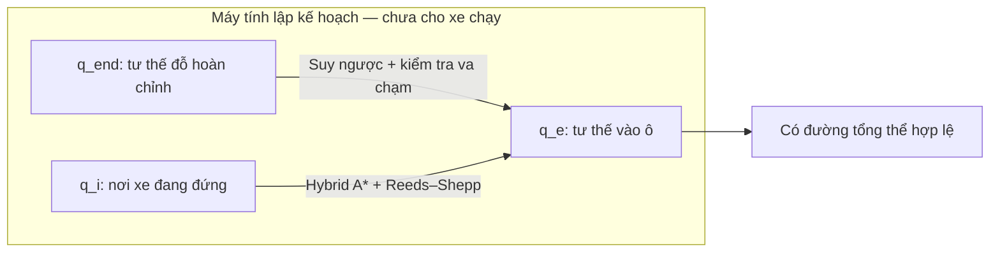
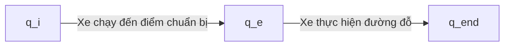

# 00 — Tổng quan: máy tính suy nghĩ thế nào để đỗ xe?

**Mục tiêu:** đọc xong biết chính xác bài toán là gì, từng thuật toán làm gì, dữ liệu được chuyền giữa các bước như thế nào. **Chưa cần học công thức khó.**

> **Bám sát bài báo:** Section 2, Figure 1, tr. 4–5; Section 3.3–3.4, tr. 9–14.

## 1. Bắt đầu từ bài toán rất đời thường

Bạn điều khiển một xe đang chạy trên làn đường, cạnh bên là một ô đỗ có hai xe chắn ở hai phía. Mục tiêu là đưa xe mình vào ô:

- Không đụng xe bên cạnh, tường, cột và biên ô đỗ;
- Không yêu cầu một cú xoay vô lý (ví dụ xe đang đi ngang như cua);
- Có thể tiến, có thể lùi và đổi hướng nhiều lần;
- Khi kết thúc phải **đúng vị trí lẫn hướng** để không chiếm chỗ xe khác.

**Tại sao chỉ nói “đưa xe tới điểm giữa ô” chưa đủ?** Một xe nằm chính giữa ô nhưng quay ngang 90° vẫn là đỗ sai. Vì vậy “đích” phải có cả tọa độ và góc.

## 2. Ba tư thế cần ghi nhớ

Đại lượng căn bản của bài báo là một **tư thế** (pose):

\[
q=(x,y,\theta).
\]

- `x`: tọa độ theo trục ngang của **bản đồ** (m);
- `y`: tọa độ theo trục dọc của **bản đồ** (m);
- `θ` (*theta*): góc thân xe quay so với trục tham chiếu (radian hoặc độ, nhưng phải thống nhất).

Ba tư thế có vai trò khác nhau:

| Ký hiệu trong tài liệu | Hiểu đơn giản | Vai trò |
|---|---|---|
| `q_i = (x_i,y_i,θ_i)` | Xe hiện đang ở đâu, quay hướng nào | Điểm bắt đầu thực tế |
| `q_e = (x_e,y_e,θ_e)` | Điểm **bắt đầu thao tác vào ô** | Điểm chuyển tiếp (*entry point*) |
| `q_end = (x_end,y_end,θ_end)` | Xe đã nằm đúng trong ô | Đích cuối |

**[BÀI BÁO]** Tác giả biểu diễn trạng thái trong mô hình động học bằng tâm trục sau `(x_r,y_r,φ)` (Section 3.1). Ở phần minh họa tìm kiếm ngược, họ đặt `P_end=(0,0,0)` trong **hệ tọa độ cục bộ**. `q_i, q_e` là ký hiệu thống nhất của **tài liệu học này** để tránh nhầm; bài báo dùng nhiều chữ cái `P`, `x`, `θ` tùy mục.

## 3. Tại sao lại tìm từ đích ngược ra ngoài?

Có hai việc khác nhau:

**Việc A — tìm cách vào đúng ô:** Nếu xe đã đỗ đúng, giả sử bạn tua ngược một đoạn phim xe ra ngoài; có thể tìm tư thế trước khi bắt đầu cú lùi vào ô. Điểm đó gọi là Entry Point. Nhưng không phải cứ tua ngược đường thẳng là thành công: thân xe có thể quẹt vào vật cản, buộc phải tính thêm các cú tiến/lùi.

**Việc B — tìm cách tới đúng vị trí chuẩn bị đó:** Sau khi biết Entry Point, máy tính bắt đầu từ nơi xe đang đứng và dùng Hybrid A* để tìm đường tới đó.

**Luồng thiết kế và luồng chạy xe là hai luồng khác nhau:**

## 4. Một ví dụ tưởng tượng xuyên suốt bộ tài liệu

**[DIỄN GIẢI]** Giả sử xe mô hình dài `0,40 m`, rộng `0,20 m`, có thể tiến/lùi. Có một ô đỗ nằm giữa hai hộp cứng. Máy tính biết hình dạng và tọa độ của các hộp.

1. Chọn đích `q_end` sao cho xe mô hình nằm ngay ngắn giữa hai hộp.
2. Sinh đường thoát mẫu từ đích để xác định một tư thế `q_e` phía ngoài ô. Ở mỗi đoạn ngắn, thử đặt mô hình thân xe vào bản đồ.
3. Nếu phần đuôi quẹt hộp, thử hướng mẫu khác hoặc shuffling; nếu không thể tìm đường hợp lệ, báo không lập được đường.
4. Khi biết `q_e`, Hybrid A* thử nhiều chuỗi `tiến/lùi + góc lái` từ `q_i`.
5. Reeds–Shepp thử tạo đường nối hình học để kết thúc nhanh hơn, cũng cần kiểm tra va chạm.
6. Ghép đường đến `q_e` và đường từ `q_e` vào ô; đưa kết quả tới bộ điều khiển.

**Lưu ý:** các số đo xe mô hình ở đây chỉ là để minh họa, **không phải thông số xe trong bài báo**.

## 5. Từng thành phần giải quyết đúng một câu hỏi

| Thành phần | Câu hỏi | Đầu vào | Đầu ra |
|---|---|---|---|
| Mô hình động học | Nếu đánh lái một góc và tiến 10 cm, xe quay thế nào? | Tư thế, góc lái, tốc độ, chiều dài cơ sở | Tư thế kế tiếp |
| Kiểm tra va chạm | Tại tư thế này, **toàn thân xe** có đè lên vật cản? | Tư thế, hình dạng thân xe, bản đồ | Hợp lệ / va chạm |
| Entry-point search | Từ chỗ đỗ hoàn chỉnh, có thể tìm một tư thế bắt đầu vào ô? | `q_end`, ô đỗ, bản đồ, ràng buộc xe | `q_e` + đường vào ô |
| Hybrid A* | Từ vị trí hiện tại đến `q_e`, nên đi hướng nào? | `q_i`, `q_e`, bản đồ, ràng buộc xe | Đường gồm các tư thế |
| Reeds–Shepp | Có nối hai tư thế bằng đường cong ngắn gồm đoạn tiến/lùi? | Hai tư thế, bán kính quay nhỏ nhất | Đường RS ứng viên |
| Hậu xử lý + bộ điều khiển | Làm sao xe di chuyển theo đường đã tính? | Đường dự kiến, trạng thái đo thực tế | Lệnh điều khiển xe |

## 6. Từ điển những chữ dễ gây nhầm

- **Path (đường đi hình học):** dãy vị trí và hướng xe phải đi qua, chưa nhất thiết nói rõ **thời gian**.
- **Trajectory (quỹ đạo theo thời gian):** đường đi đã gán thêm thông tin thời gian/tốc độ; trong nhiều bài báo từ *path* và *trajectory* đôi khi dùng tương đối linh hoạt.
- **Pose (tư thế):** `x,y,θ`, không đồng nghĩa chỉ một điểm không có hướng.
- **Start / Goal:** bắt đầu / đích của **một bài toán con**, nên trong Hybrid A* đích có thể là `q_e`, không nhất thiết `q_end`.
- **Nonholonomic (ràng buộc không toàn phương):** xe thông thường không thể lướt ngang tùy ý như quân cờ trên bàn cờ.
- **Motion primitive (động tác di chuyển mẫu):** một đoạn tiến/lùi trong đó góc lái được chọn trước để máy tính thử.
- **Reverse search (tìm ngược):** máy tính xét từ tư thế cuối ra trước; **không đồng nghĩa** bắt xe thật lùi.
- **Reverse gear (số lùi):** hướng chuyển động vật lý có vận tốc dấu âm theo quy ước.
- **Shuffling (chỉnh tiến/lùi nhiều lần):** đổi chiều để dần chỉnh tư thế trong nơi hẹp.
- **Collision-free (không va chạm):** không giao nhau với vật cản trong **mô hình được kiểm tra**; không phải bảo đảm tuyệt đối ngoài đời khi cảm biến sai.
- **Heuristic (ước lượng dẫn đường):** phép tính giúp ưu tiên nút có vẻ gần đích, không phải quỹ đạo xe có thể chạy ngay.

## 7. Hiểu sơ đồ Figure 1 của bài báo (tr. 4)

Figure 1 chia 3 nhóm chính:

1. **Đầu vào và mô hình môi trường:** trạng thái xe, bản đồ, chỗ đỗ, chướng ngại.
2. **Lập kế hoạch:** đánh giá khả thi của ô đỗ → tìm Entry Point → RS + Hybrid A* → kết quả đường đi.
3. **Kiểm tra va chạm phân cấp:** dùng hình chữ nhật và mô hình nhiều hình tròn để tránh phép kiểm tra vừa tốn CPU vừa dễ lọt va chạm.

**[CẦN KIỂM CHỨNG]** Hình 1 tóm lược luồng; các chi tiết nội bộ thuật toán phải xem Section 3.2–3.4 thay vì suy từ một mũi tên trong hình.

## 8. Bài báo đã làm được gì, và chưa thể kết luận gì?

**[BÀI BÁO]** Mô phỏng MATLAB trên i7-11800H/32 GB RAM: đỗ song song, phương pháp được đề xuất `0,543 s` toàn quy trình so với baseline `32,700 s`; đỗ vuông góc `0,888 s` so với `1,478 s` (Mục 4, tr. 14–17). Thử nghiệm xe Denza N7 dùng **máy tính trên xe chạy C++ cho lập đường, MPC để bám đường** (Mục 5, tr. 18).

Không thể tự suy ra:

- STM32 nào cũng đạt cùng tốc độ;
- Tất cả cảnh thật ngoài đời đều được giải;
- Reeds–Shepp tự tránh được mọi vật cản;
- Có công thức chính xác để tái tạo mọi hệ số mà bài báo đã thử.

## 9. Tự kiểm tra

1. Tại sao một ô đỗ không thể biểu diễn bằng một tọa độ `x,y` duy nhất?
2. Nếu `q_e` đã tìm được nhưng không có đường từ `q_i`, hệ thống có hoàn thành không?
3. Thuật toán nào **tính** đường, thuật toán nào **điều khiển** xe chạy theo đường?
4. Xe thật có phải chạy ra khỏi ô trước để tìm Entry Point không?

**Đi tiếp:** [01_Co_so_dong_hoc.md](01_Co_so_dong_hoc.md) — để hiểu tại sao xe không thể đổi hướng tùy tiện.
