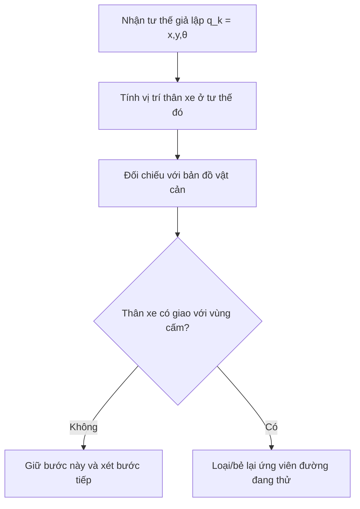
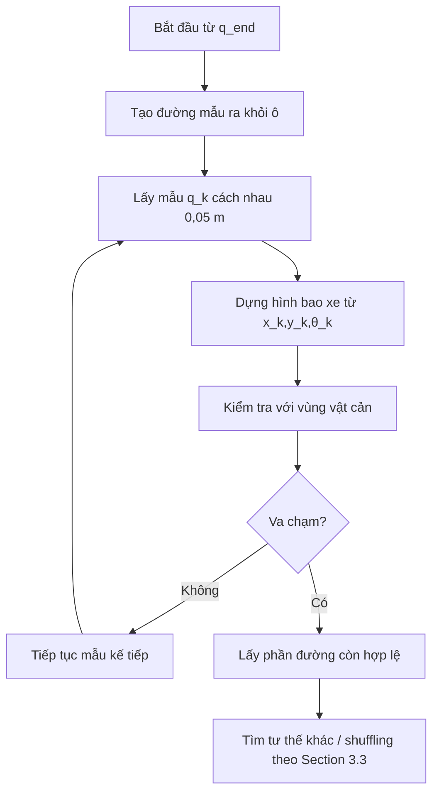

# 02 — Kiểm tra va chạm: máy tính biết xe giả lập có đâm vào vật cản thế nào?

> **Nguồn chính:** Section 3.2, Figures 3–4; công thức (7)–(20), tr. 6–9. Liên hệ bước lấy mẫu 0,05 m ở Section 3.3, tr. 11.
>
> **Đọc xong phải trả lời được:** Từ `q_end` thử tìm ngược 5 cm rồi 5 cm nữa, làm sao biết một bước đang làm thân xe quẹt xe bên cạnh?

## 1. Bản chất: đây là “thử trên bản đồ”, không phải thử xe thật

Trong thuật toán, xe thật **chưa hề đi**. Máy tính có một mô hình xe (chiều dài, rộng, tư thế) và một bản đồ ghi vị trí vật cản. Nó tự giả lập một loạt tư thế:

`q_0=(x_0,y_0,θ_0) → q_1 → q_2 → ... → q_7`.

Ở mỗi `q_k`, nó lấy **toàn bộ hình dạng thân xe** đặt vào bản đồ. Nếu vùng thân xe chồng lên vùng của vật cản (kể cả một phần mũi/đuôi), tư thế `q_k` bị coi là va chạm.



**Điểm quan trọng:** Phần 02 này được dùng **cả trong tìm ngược Entry Point lẫn khi Hybrid A* thử nhánh mới**, không phải hai thuật toán va chạm hoàn toàn khác nhau.

## 2. Vì sao kiểm tra một “điểm tâm” là sai?

**[DIỄN GIẢI]** Tưởng tượng xe dài 4 m, rộng 2 m. Tâm xe cách cạnh vật cản 1,2 m, nghe có vẻ an toàn. Nhưng nếu xe quay 45°, một góc xe nhô ra hơn 1,2 m và **chạm** vật cản. Trong khi tọa độ tâm chẳng hề nằm trong vật cản.

Vì vậy phải mô hình hóa **footprint**: vùng mặt đất mà thân xe chiếm chỗ.

Từ vựng:

- **Obstacle:** chướng ngại/vật cản.
- **Collision:** giao nhau về mặt hình học trong mô hình.
- **Footprint:** hình chiếu thân xe xuống mặt đường.
- **Bounding box:** hình bao đơn giản dùng thay hình thực phức tạp.
- **Occupancy grid:** bản đồ chia các ô vuông, ô nào có vật cản thì đánh dấu `1`, ô trống đánh dấu `0`.
- **Collision checking:** phép kiểm tra có giao nhau hay không.

## 3. Cách A — dùng hình chữ nhật bao thân xe

### 3.1. Đầu tiên, dựng xe trong hệ tọa độ riêng của nó

Giả sử chiều dài thân xe là `L_car`, chiều rộng `W_car`. Đặt **tâm hình học** của xe là `(0,0)` trong hệ trục gắn với xe, trục dọc thân là `u`, trục ngang thân là `v`.

Bốn góc của hình chữ nhật là:

\[
(-L_{car}/2,-W_{car}/2),\quad
(-L_{car}/2,+W_{car}/2),
\]
\[
(+L_{car}/2,+W_{car}/2),\quad
(+L_{car}/2,-W_{car}/2).
\]

**Tại sao chia 2?** Vì tâm ở giữa: từ tâm ra mũi xe bằng nửa chiều dài, từ tâm sang bên trái bằng nửa chiều rộng.

**[BÀI BÁO]** Đây là các tọa độ trong **công thức (14)**, Section 3.2.2. Lưu ý tác giả dùng `L_r,W_r` cho kích thước thân xe trong mô hình này, **khác** `L` là chiều dài cơ sở ở Section 3.1.

### 3.2. Khi thân xe quay, 4 góc trên bản đồ ở đâu?

Ví dụ một góc của xe có tọa độ nội bộ `(u,v)`; khi xe quay `θ` rồi tịnh tiến đến `(x,y)`, ta được:

\[
\boxed{X=x+u\cos\theta-v\sin\theta}
\]
\[
\boxed{Y=y+u\sin\theta+v\cos\theta}.
\]

Cặp công thức trên chính là **nhân ma trận quay**:

\[
\begin{bmatrix}X\\Y\end{bmatrix}=
\begin{bmatrix}x\\y\end{bmatrix}+
\begin{bmatrix}\cos\theta&-\sin\theta\\\sin\theta&\cos\theta\end{bmatrix}
\begin{bmatrix}u\\v\end{bmatrix}.
\]

Từ đâu ra? Vector theo trục dọc `(u,0)` khi quay `θ` trở thành `(u cosθ,u sinθ)`; vector theo trục ngang `(0,v)` trở thành `(-v sinθ,v cosθ)`; **cộng hai vector và cộng tọa độ tâm** sẽ ra kết quả.

**[BÀI BÁO]** Đây là bản chất của **công thức (16)**.

### 3.3. Ví dụ số từ đầu: quay xe 90°

**[DIỄN GIẢI]** Xe dài `4m`, rộng `2m`; điểm tâm hình học trên bản đồ `(x,y)=(10,10)`; xe quay `θ=90°`.

Một góc ở đầu xe bên trái, trong hệ thân xe `(u,v)=(2,1)`.

Vì `cos90°=0`, `sin90°=1`:

- `X = 10 + 2×0 − 1×1 = 9`;
- `Y = 10 + 2×1 + 1×0 = 12`.

Vậy góc này trên bản đồ là `(9,12)`. Bạn có thể làm tương tự cho ba góc khác. Máy tính chỉ thực hiện phép nhân và cộng như vậy, không “nhìn ảnh” để đoán xe có va chạm.

### 3.4. Thử kiểm tra xe có va vào một hộp cứng?

Từ 4 góc vừa tính, ta biết hình chữ nhật định hướng của xe (OBB — *oriented bounding box*). Muốn biết nó giao hình chữ nhật vật cản có thể dùng phép kiểm tra giao đa giác hoặc *Separating Axis Theorem (SAT)*.

**[DIỄN GIẢI]** Trong trường hợp dễ nhất `θ=0°`, thân xe chiếm `x∈[8,12]`, `y∈[9,11]`. Hộp vật cản chiếm `x∈[11,13]`, `y∈[10,12]`. Vì các khoảng x và y **đều** chồng lên nhau, hai hình giao nhau → va chạm.

**[BÀI BÁO]** Tác giả mô tả lấy nhiều **điểm mẫu dọc bốn cạnh** hình chữ nhật, tạo tập `Q^(b)` ở công thức (15), sau đó chuyển các điểm sang bản đồ ở (16), so sánh với bản đồ vật cản mở rộng ở (17)–(20).

### 3.5. Các công thức kiểm tra vùng chữ nhật (17)–(20) trong bài báo

**[BÀI BÁO]** Bài định nghĩa độ nửa dài `r_x=L_r/2` và nửa rộng `r_y=W_r/2`, sau đó gọi `R_r(r_x,r_y)` là phần tử hình chữ nhật đối xứng quanh gốc:

\[
R_r(r_x,r_y)=\{(u,v)\mid |u|\le r_x,\ |v|\le r_y\}.\tag{18}
\]

Nói không dùng ký hiệu: đó là tập những điểm nằm trong một hình chữ nhật có chiều dài `2r_x` và chiều rộng `2r_y`. Ký hiệu `|u|≤r_x` nghĩa tọa độ ngang từ `−r_x` đến `+r_x`.

**[BÀI BÁO, (17)]** Vùng vật cản `O_r` được nở bằng phần tử hình chữ nhật trên:

\[
O_r^{\oplus}=O_r\oplus R_r(r_x,r_y).\tag{17}
\]

Ở đây `⊕` vẫn là phép Minkowski sum giải thích ở mục 5. Nếu bản đồ lưu thành ma trận `M_r^⊕`, tác giả kiểm tra xem **có điểm mẫu nào trên hình chữ nhật xe** nằm trong vùng nở hay không:

\[
\exists j:\ q_j^{(g)}\in O_r^{\oplus}\quad\Longrightarrow\quad\text{va chạm},\tag{19}
\]

\[
M_r^{\oplus}(x_j,y_j)=1\quad\Longrightarrow\quad\text{va chạm}.\tag{20}
\]

Trong đó `q_j^(g)` là điểm thứ `j` trên mép xe sau khi chuyển sang hệ tọa độ bản đồ bằng công thức (16). `x_j,y_j` là tọa độ của điểm đó. Hiểu đơn giản, máy tính tra xem một trong những điểm đang thử có nằm trong các ô lưới bị đánh dấu “cấm” hay không.

**[CẦN KIỂM CHỨNG]** Công thức (17)–(20) mô tả vừa mở rộng vật cản bằng phần tử hình chữ nhật cỡ thân xe, vừa lấy điểm trên **mép thân xe** để kiểm tra. Nếu tái lập mã, không nên mặc nhiên coi đây là phép kiểm tra SAT chính xác hoặc tăng kích thước vật cản **hai lần**: phải xác định rõ phần mở rộng đóng vai trò đệm an toàn hay thay thế phép thử footprint. Tài liệu này giữ nguyên ý và số hiệu công thức của bài, nhưng đưa SAT thành phương án kiểm chứng độc lập khi triển khai.

## 4. Cách B — dùng 10 hình tròn dọc thân xe

Bài báo dùng cách này để tính nhanh khi phải kiểm tra rất nhiều tư thế (Figure 3 và công thức (7)–(13)).

### 4.1. Vì sao lại vẽ hình tròn?

Với hình tròn, va chạm với một điểm vật cản có thể phát hiện bằng **khoảng cách Euclid** — phép tính Pythagoras quen thuộc:

\[
d=\sqrt{(X_1-X_2)^2+(Y_1-Y_2)^2}.
\]

Hai hình tròn tâm cách nhau `d` sẽ chạm nhau khi `d ≤ r_1+r_2`. Hình tròn **không cần quay** khi xe đổi hướng, vì tròn nhìn hướng nào cũng như nhau.

### 4.2. Bài báo chọn 10 hình tròn như thế nào?

Gọi `L_car` là chiều dài **thân xe**, `W_car` là chiều rộng; số hình tròn `N=10`.

**[BÀI BÁO, công thức (7)]**

\[
\boxed{r=W_{car}/2}.
\]

Tức mỗi hình tròn có bán kính bằng **nửa bề ngang xe**. Nếu xe rộng `1,8m`, mỗi hình có `r=0,9m`.

**[BÀI BÁO, công thức (8)]**

\[
\boxed{d=L_{car}/(10-1)=L_{car}/9}.
\]

Tại sao chia `9` chứ không chia `10`? Có 10 tâm được đặt từ đầu tới cuối xe thì chỉ có **9 khoảng cách** giữa các tâm liên tiếp.

**[BÀI BÁO, công thức (9)]**

\[
\boxed{u_i=-\frac{L_{car}}2+(i-1)d,\quad v_i=0,\quad i=1,2,\ldots,10.}
\]

Nghĩa là hình tròn đầu tiên nằm ở `-L_car/2`, hình cuối ở `+L_car/2`, 8 hình còn lại rải đều. Tất cả tâm nằm trên **trục dọc giữa xe**.

**Ví dụ:** xe dài `4,5m`, rộng `1,8m`:

- Bán kính mỗi hình: `0,9m`;
- Khoảng giữa hai tâm: `4,5/9=0,5m`;
- Tâm 1: `u=-2,25m`; tâm 2: `-1,75m`; ... tâm 10: `+2,25m`.

Hình sau là sơ đồ ý tưởng, không theo tỉ lệ chuẩn:

```text
                 Trục dọc thân xe
  đầu sau                                     đầu trước
   (o)---(o)---(o)---(o)---(o)---(o)---(o)---(o)---(o)---(o)
       Khoảng cách d giữa hai tâm liên tiếp
  Mỗi (o) là vùng tròn bán kính r = W_car/2
```

### 4.3. Từ tâm tròn trong thân xe sang tâm tròn trên bản đồ

Vẫn dùng phép quay và tịnh tiến ở mục 3:

\[
X_i=x+u_i\cos\theta-v_i\sin\theta,
\]
\[
Y_i=y+u_i\sin\theta+v_i\cos\theta.
\]

Vì `v_i=0`, thành:

\[
\boxed{X_i=x+u_i\cos\theta,\qquad Y_i=y+u_i\sin\theta.}
\]

**[BÀI BÁO]** Đây là trường hợp cụ thể của **công thức (10)**.

**[CẦN KIỂM CHỨNG]** Mô hình động học dùng **tâm trục sau**, còn công thức 10 hình tròn đặt gốc tại **tâm hình học thân xe**. Khi lập trình, phải quy đổi từ tâm trục sau sang tâm thân xe bằng độ lệch dọc `a` (đo theo kích thước xe): `x_center=x_rear+a cosθ`, `y_center=y_rear+a sinθ`. Bài báo chưa cho đầy đủ offset này theo cùng một bảng ký hiệu; không được âm thầm đồng nhất hai gốc tọa độ.

### 4.4. Độ chính xác của xấp xỉ 10 hình tròn

**[DIỄN GIẢI]** Vì hai tâm ngoài cùng nằm tận `±L_car/2` mà mỗi hình còn nhô thêm `r` ở đầu, vùng hợp của 10 hình tròn có thể **lớn hơn thân xe thực**. Điều đó có lợi cho kiểm tra bảo thủ (thà loại một đường có vẻ sát), nhưng cũng có thể loại nhầm một đường không chạm thân xe thật trong không gian cực hẹp. Hãy kiểm chứng với kiểm tra hình chữ nhật định hướng/SAT hoặc đa giác chuẩn trên bộ cảnh thử. Đây là nhận xét hình học từ định nghĩa mô hình, **không phải phép đo sai số do tác giả công bố**.

## 5. Vì sao bài báo “phình” vật cản ra trước?

Từ vựng:

- **Obstacle inflation / dilation:** nới rộng vùng chiếm chỗ của vật cản ra thêm một khoảng.
- **Minkowski sum `⊕`:** phép dựng tập tất cả vị trí sau khi cộng một điểm trong tập A với một điểm trong tập B. Trong trường hợp vật cản + đĩa tròn bán kính `r`, đó là cách nói toán học của “nở vật cản ra `r` mét”.

Ví dụ **[DIỄN GIẢI]**: một bức tường ở `x=3m` và hình tròn bán kính `0,5m` đang tiến lại. Thay vì xem toàn hình tròn chạm tường, ta giả sử **tâm tròn là một chấm** và cấm chấm này đến gần tường dưới `0,5m`. Hai cách kiểm tra **tương đương về hình học** đối với hình tròn.

**[BÀI BÁO, công thức (11)]**

\[
O^{\oplus}=O\oplus B(0,r),
\]

- `O` = vùng vật cản ban đầu;
- `B(0,r)` = đĩa bán kính `r` có tâm `(0,0)`;
- `O^⊕` = vùng vật cản sau khi nở thêm bán kính `r`.

Sau đó kiểm tra 10 **tâm** hình tròn `P_i=(X_i,Y_i)`:

\[
\boxed{\exists i\colon P_i\in O^{\oplus}\quad\Longrightarrow\quad\text{va chạm}.}
\]

Đọc từng ký hiệu: `∃` = “có tồn tại ít nhất một”; `∈` = “nằm trong”; `⇒` = “suy ra”. Chỉ cần **một trong 10 tâm** nằm trong vùng cấm là cả tư thế bị loại. Đây là công thức (12).

Nếu lưu bản đồ dạng lưới nhị phân `M^⊕`:

\[
M^{\oplus}(X_i,Y_i)=1\quad\Longrightarrow\quad\text{va chạm}.
\]

Đây là ý nghĩa công thức (13): thay hình học phức tạp bằng thao tác “tra ô trong mảng 2 chiều”.

## 6. Bản đồ lưới (`Occupancy grid`) là gì?

**[DIỄN GIẢI]** Chia bãi đỗ thành các ô `10cm×10cm`. Ma trận có giá trị:

```text
0 0 0 0 1 1
0 0 0 0 1 1
0 0 0 0 1 1
0 0 0 0 0 0
0 0 0 0 0 0
```

Trong đó `1` là vật cản, `0` là trống. Với điểm tọa độ thế giới `(X,Y)` và gốc bản đồ `(x_min,y_min)`, ô tương ứng xấp xỉ:

\[
col=\left\lfloor\frac{X-x_{min}}{resolution}\right\rfloor,\quad
row=\left\lfloor\frac{Y-y_{min}}{resolution}\right\rfloor.
\]

**`⌊⌋`** = lấy phần nguyên xuống; `resolution` = kích thước cạnh mỗi ô. Ví dụ `X=1,35m`, `x_min=0`, `resolution=0,1m` → `col=floor(13,5)=13` nếu đếm từ số 0.

**[ĐỀ XUẤT STM32]** Cần quy định rõ ngoài biên bản đồ là *không biết* hay *vật cản*. Với hệ đỗ xe an toàn, không được mặc định vùng chưa biết là trống.

## 7. Khi xe di chuyển, có phải chỉ kiểm tra điểm đầu và điểm cuối?

**Không.** Đây là chỗ dễ hiểu sai nhất.

Một đoạn quay đầu có thể bắt đầu ở A (không va chạm), kết thúc ở B (không va chạm), nhưng **mũi xe quét qua cột** giữa A và B. Vì vậy cần lấy mẫu nhiều tư thế trung gian.

**[BÀI BÁO]** Ở phần tìm Entry Point, đường mẫu được rời rạc thành các điểm với `Δs=0,05m` (tr. 11, Section 3.3). `s` là **quãng đường** dọc cung, không phải thời gian. Các đoạn RS ở tr. 14 cũng được rời rạc rồi kiểm tra bằng mô hình nhiều hình tròn.

**[DIỄN GIẢI]** Nếu một đoạn đường dài `0,25m`, lấy mẫu mỗi `0,05m`:

| Mẫu | Đã đi dọc đường | Kết quả mô phỏng |
|---|---:|---|
| 0 | 0,00 m | Trống |
| 1 | 0,05 m | Trống |
| 2 | 0,10 m | Trống |
| 3 | 0,15 m | **Va chạm** |
| 4 | 0,20 m | Không cần nhận đoạn này là hợp lệ |
| 5 | 0,25 m | Không cần nhận đoạn này là hợp lệ |

Tại mẫu 3, tính tư thế `(x_3,y_3,θ_3)`, 10 tâm tròn hoặc các điểm trên thân xe, rồi kiểm tra bản đồ. Một tâm tròn nằm trong vùng cấm → đoạn này không đủ điều kiện.

**[CẦN KIỂM CHỨNG]** Kiểm tra các mẫu rời rạc **không tự động bảo đảm an toàn liên tục** giữa hai mẫu, đặc biệt với góc quay lớn, vật cản mảnh hoặc bản đồ sai số. Triển khai nên dùng biên an toàn, bước mẫu đủ nhỏ và nếu cần phép kiểm tra vùng **quét liên tục** (*swept collision checking*).

## 8. Bài báo dùng hình chữ nhật hay 10 hình tròn ở đâu?

Đọc nguồn cần lưu ý **cách mô tả chưa hoàn toàn nhất quán**:

- Section 2 (tr. 5) nói hình chữ nhật dùng kiểm tra thô khi tìm Entry Point và Hybrid A*, mô hình nhiều hình tròn dùng kiểm tra tinh trên RS.
- Section 3.2 (tr. 6–7) mô tả hình chữ nhật cho bài toán tìm Entry Point chật hẹp; mô hình nhiều hình tròn trong lập đường với tần suất kiểm tra cao.
- Section 3.4 (tr. 14) chỉ rõ đường RS được lấy mẫu và kiểm tra bằng mô hình nhiều hình tròn.

**Cách hiểu có căn cứ:** nghiên cứu dùng **hai đại diện hình học tùy giai đoạn**, nhưng không thể dựa vào bài báo để kết luận mọi câu lệnh `if` trong mã nguồn được xếp chính xác theo một lịch cố định. Khi triển khai phải tự thiết kế và kiểm thử cả hiệu năng lẫn độ phủ an toàn.

## 9. Kiểm tra va chạm và kiểm tra khoảng cách có khác nhau?

- **Collision check:** nhị phân *có giao nhau hay không*.
- **Clearance check:** đo *còn cách vật cản bao nhiêu*, ví dụ 15 cm.
- **Safety margin `Δ_safe`:** đệm an toàn để không chỉ vừa khít bằng 0 mm.

Nếu cảm biến khoảng cách có sai số, xe phải có khoảng cách an toàn lớn hơn sai số dự kiến. Tuy nhiên, bản đồ và collision checker tính toán dựa trên **dữ liệu được cung cấp**; chúng không tự chữa được dữ liệu cảm biến sai.

## 10. Sơ đồ vai trò trong Entry-Point search



**Đừng hiểu nhầm:** đây là **mô phỏng trên RAM của máy tính**. Xe thật không cần thử đâm một lần nào để biết nhánh không được chọn.

## 11. Câu hỏi tự kiểm tra

1. Nếu tâm xe nằm ngoài vật cản nhưng một góc xe chạm, kết quả là gì? → Va chạm.
2. Có 10 hình tròn và 9 hình tròn an toàn, một hình tròn giao vùng cấm? → Va chạm.
3. Nới vật cản ra `r` rồi xét **tâm** hình tròn có tác dụng gì? → Thay phép giao hình tròn–vật cản bằng phép xét điểm–vùng cấm.
4. Vì sao 5 cm là lấy mẫu **quãng đường** mà không phải tốc độ? → Vì kiểm tra các tư thế phân bố dọc đường hình học, chưa cần xe thật chạy theo thời gian.
5. Bài báo có chứng minh mọi vị trí giữa hai mẫu 5 cm luôn an toàn tuyệt đối không? → Không, không được suy như vậy.

**Đi tiếp:** [03_Tim_Entry_Point.md](03_Tim_Entry_Point.md) để xem collision checker vừa học được gọi lúc tìm ngược như thế nào.
