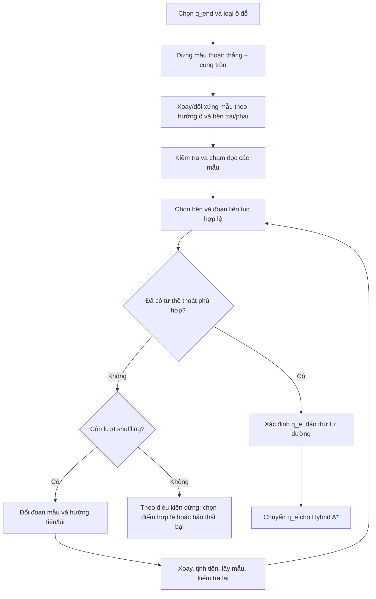

# 03 — Tìm Entry Point: từ q_end suy ngược ra q_e như thế nào?

> **Nguồn:** Section 3.3, Figures 5–6; công thức (21)–(28), tr. 9–13.
>
> **Mục tiêu:** hiểu rõ từng bước **máy tính** xây một đường ngược từ tư thế đã đỗ, phát hiện va chạm, đổi hướng và lấy điểm vào ô. Đây là điểm đóng góp lớn của bài báo.

## 1. Trước hết: `Entry Point` là *tư thế* chứ không phải chỉ một điểm

Trong tài liệu này:

\[
q_e=(x_e,y_e,\theta_e).
\]

Đó là vị trí và góc xe cần đạt **trước khi thực hiện đoạn đỗ cuối cùng**. Nếu chỉ có `x_e,y_e` mà không biết `θ_e`, xe có thể tới đúng chỗ nhưng nằm sai hướng và không lùi vào ô được.

**[BÀI BÁO]** Tác giả coi Entry Point là một tư thế “nút cổ chai” (*bottleneck pose*): tìm trước tư thế này có thể giúp Hybrid A* tránh mở rộng rất nhiều nút vô ích trong không gian hẹp (Introduction và Section 3.3).

## 2. Tại sao không tìm một lèo từ q_i đến q_end?

Một ô đỗ chật có nhiều tư thế xe **ở gần đích về mặt tọa độ** nhưng **không thể vào đích được** vì bán kính quay, thân xe, xe chắn hai bên. Nếu Hybrid A* thử trực tiếp tất cả, nó có thể mất nhiều thời gian mở rộng nhiều đường không khả thi.

Ý tưởng của bài báo: giải từ **phần khó nhất gần ô đỗ trước**, rồi mới giải phần từ xa đi tới khu vực đó.

```text
Tư thế ban đầu q_i                            Tư thế đích q_end
        A                                             C
         \                                           /
          \___ Hybrid A* tới q_e ____ B ___________/
                                   Entry Point

Muốn xây đoạn B→C đáng tin cậy, thử tư duy ngược C→B trước.
```

**Đảo hướng tính toán không có nghĩa xe đang được ra lệnh lùi:** toàn bộ bước này diễn ra trong thuật toán tìm đường.

## 3. Chuẩn hóa tư thế đích về `(0,0,0)`

**[BÀI BÁO, Section 3.3]** Bài định nghĩa `P_end=(0,0,0)` để xây một đường mẫu chuẩn.

Tại sao được phép làm vậy? Vì có thể chọn hệ tọa độ **gắn vào ô đỗ**, coi đích là gốc và hướng đích là `0°`. Sau khi tính xong, toàn bộ điểm mẫu được **xoay và tịnh tiến** trở lại bản đồ thật.

Ví dụ `[DIỄN GIẢI]`: ô đỗ ở tọa độ bản đồ `(100,50)` và xe cần hướng `90°`. Trong hệ tọa độ ô đỗ, điểm đích được gán `(0,0,0)` để công thức ngắn gọn; khi vẽ bản đồ thật, nó vẫn phải nằm ở `(100,50,90°)`.

## 4. Bước 1 — Tạo đường mẫu “thoát ra khỏi ô”

**[BÀI BÁO, công thức (21)]** Tác giả dùng:

\[
\boxed{L_1=R_{min}+\Delta_{safe}}.
\]

Giải nghĩa từng chữ:

- `L_1`: chiều dài đoạn đường thẳng trong mẫu thoát ô;
- `R_min`: bán kính quay nhỏ nhất của xe (xem file 01);
- `Δ_safe`: **khoảng bù an toàn** để tăng khoảng hở, tính đến bề rộng xe, biên trống và mở rộng vật cản;
- Dấu `+`: đoạn thẳng dài hơn bán kính quay một khoảng đệm.

**Tại sao có `R_min`?** Vì xe không thể bẻ góc gấp tức thời. Một mẫu thoát có đoạn thẳng đủ dài để dành không gian cho phần cung tròn kế tiếp. Đây là **mẫu hình học do tác giả lựa chọn**, không phải công thức duy nhất bắt buộc cho mọi ô đỗ.

Tiếp theo, đường mẫu chứa **một cung tròn 1/4 vòng**, bán kính `R_min`, góc quay:

\[
\Delta\theta=\pi/2 =90^\circ.
\]

Vì `π rad = 180°`, nên `π/2 rad = 90°`: quay đầu xe từ hướng dọc ô đỗ sang hướng gần vuông góc với hướng đó ở ngoài ô.

Bài báo xây mẫu trái, rồi dùng đối xứng hình học để có mẫu phải. Cần nhớ **thứ tự và dấu tiến/lùi là theo cách tác giả dựng mẫu thoát**, sau đó đảo thứ tự đường để có đường vào ô; không được tùy tiện hiểu mọi đoạn “tìm ngược” là lùi xe vật lý.

### Ví dụ có số

**[DIỄN GIẢI]** Dùng `R_min=6m` theo Table 1, **giả sử thêm** `Δ_safe=0,3m`:

\[
L_1=6+0,3=6,3m.
\]

Một cung tròn 1/4 vòng bán kính `6m` có độ dài:

\[
s_{arc}=R\,\Delta\theta=6\times\frac\pi2\approx9,42m.
\]

**Vì sao `s=Rθ`?** Vì chu vi cả vòng là `2πR` ứng với `2π` rad, nên một cung góc `θ` có chiều dài tỉ lệ `Rθ`.

**Cảnh báo:** con số `Δ_safe=0,3m` trong ví dụ **không được bài báo chốt là tham số của công thức (21)**; Table 1 có khoảng cách an toàn ngang 0,3 m nhưng không tuyên bố trực tiếp `Δ_safe=0,3m` cho mọi đường mẫu.

## 5. Bước 2 — Chia nhỏ đường mẫu để thử từng tư thế

**[BÀI BÁO]** Bước lấy mẫu `Δs=0,05m` (5 cm) ở tr. 11.

Giả sử đường mẫu dài 2 m thì có xấp xỉ `2/0,05 = 40` khoảng đường. Với từng điểm mẫu lưu:

\[
q_k=(x_k,y_k,\theta_k).
\]

**Phần quan trọng nhất trả lời câu hỏi trước đó của bạn:** tại **mỗi** `q_k`, máy tính đặt **mô hình hình chữ nhật của thân xe** vào đúng vị trí và góc đã tính, rồi kiểm tra với bản đồ vật cản. Không cần xe thật lái thử.

Nếu mẫu đi qua vật cản ở điểm 15, điểm đó không được thêm vào phần đường hợp lệ. Nó biết bằng phép tính hình học trong [02_Kiem_tra_va_cham.md](02_Kiem_tra_va_cham.md).

### Ví dụ 6 điểm trong RAM

| Điểm | Đường đã xét (ví dụ) | Thân xe có chạm vật cản? | Diễn giải |
|---|---:|---|---|
| `q_0` | 0 cm | Không | Xe nằm trong ô |
| `q_1` | 5 cm | Không | Mẫu thoát hợp lệ |
| `q_2` | 10 cm | Không | Hợp lệ |
| `q_3` | 15 cm | Không | Hợp lệ |
| `q_4` | 20 cm | **Có** | Mũi xe quẹt góc xe bên cạnh |
| `q_5` | 25 cm | Không xét như một phần nối tiếp hợp lệ | Đường mẫu bị chặn tại đây |

**[DIỄN GIẢI]** Các kết quả số trên chỉ để mô tả quy trình, không phải bảng dữ liệu thực nghiệm trong bài báo.

## 6. Bước 3 — Chọn bên trái hay bên phải

Đường mẫu có thể đưa xe thoát ô về **bên trái** hoặc **bên phải**. Bài báo kiểm tra từ đích ra theo hai mẫu, đếm số điểm **liên tục không va chạm**:

- `N_L`: số mẫu hợp lệ liên tục cho đường bên trái;
- `N_R`: số mẫu hợp lệ liên tục cho đường bên phải.

**[BÀI BÁO, tr. 11]** Quy tắc nêu rõ:

1. Nếu `|N_L - N_R| ≥ 2`, ưu tiên phía có nhiều điểm liên tục hợp lệ hơn.
2. Nếu chênh lệch nhỏ hơn 2, xét thêm tư thế đầu và hướng thoát, chọn hướng có chuyển động tự nhiên, ít đánh lái/nguy cơ va chạm hơn.

**Từ toán học:** `|a-b|` nghĩa là **giá trị tuyệt đối** (bỏ dấu âm). Nếu trái có 28 mẫu, phải có 18 mẫu, `|28-18|=10≥2` → chọn trái. Nếu trái 21, phải 20, chênh lệch `1` → cần tiêu chí bổ sung.

Chọn nhiều điểm hơn không có nghĩa đã **chứng minh** đây là đường tốt nhất trên mọi bãi đỗ. Đây là quy tắc chọn ứng viên của phương pháp nghiên cứu.

## 7. Bước 4 — Shuffling: nếu không thoát được chỉ bằng một đường mẫu

Từ vựng:

- **Shuffling:** thao tác chỉnh xe **tiến rồi lùi** hoặc **lùi rồi tiến** để dần thay đổi vị trí, hướng trong không gian hạn chế.
- **Iteration:** một vòng lặp tính toán.
- **Path template:** mẫu đường thẳng/cung tròn được tạo trước rồi đổi góc và vị trí cho phù hợp tư thế hiện tại.
- **Feasible segment:** đoạn có độ dài chấp nhận được và không bị va chạm theo mô hình.

**[BÀI BÁO]** Figure 6 (tr. 12) mô tả luồng tìm kiếm lặp: tạo đoạn thử, kiểm tra va chạm, xét ngưỡng chiều dài, xét góc hướng, đổi hướng tiến/lùi và tiếp tục nếu cần. Phần giải thích giới hạn tối đa **4 lần** shuffling.

### Hình dung bằng ô đỗ hẹp

Giả sử đường mẫu thoát phải bị cột chắn, đường thoát trái cũng chạm một xe. Thay vì dừng ngay, máy tính có thể thử:

1. Giữ đoạn hợp lệ đầu tiên từ đích;
2. Tại một tư thế hiện tại, đặt mẫu khác quay/đổi hướng;
3. Tính lại toàn bộ các điểm mẫu sau đổi hướng;
4. Kiểm tra va chạm **lại từ đầu** trên đoạn mới;
5. Lặp cho đến khi có tư thế phù hợp ở ngoài hoặc vượt điều kiện dừng.

Không phải thuật toán “đẩy” xe xuyên vật cản. Mỗi đoạn mới vẫn phải vượt kiểm tra hình học.

## 8. Công thức chỉnh hướng mẫu (24)–(26): giải từ đầu

Ở vòng lặp thứ `k`, điểm bắt đầu cho đoạn hiện tại là:

\[
\boxed{P_{start}^{(k)}=(x_k,y_k,\theta_k).}\tag{24}
\]

**Đây chỉ là cách ghi một bộ ba**, chưa phải phương trình vật lý. Chỉ số `(k)` cho biết “vòng thứ k”.

Một đường mẫu ban đầu có hướng gốc `θ_base`. Nhưng xe hiện đang quay hướng `θ_k`. Muốn ghép mẫu vào xe này, phải **quay cả mẫu** một góc:

\[
\boxed{\varphi=\theta_k-\theta_{base}+\delta_{dir}.}\tag{25}
\]

- `φ` ở đây là **góc quay mẫu**, không nên nhầm với `φ` hướng thân xe trong Section 3.1;
- `θ_k − θ_base`: phần chênh giữa hướng hiện tại và hướng gốc mẫu;
- `δ_dir`: góc hiệu chỉnh khi đổi kiểu tiến/lùi theo định nghĩa trong bài báo; **không phải** góc lái bánh trước `δ` ở mô hình xe đạp.

Ví dụ **[DIỄN GIẢI]**: mẫu gốc quay `0°`, xe hiện tại `30°`, `δ_dir=0°` thì cần quay mẫu `φ=30°`. Sau khi quay mẫu, mỗi điểm có góc cũ `θ'_i` trở thành:

\[
\boxed{\theta''_i=\theta'_i+\varphi.}\tag{26}
\]

Nếu `θ'_i=20°`, `φ=30°` thì `θ''_i=50°`. Các tọa độ `x,y` của điểm mẫu **cũng** phải quay và tịnh tiến theo phép biến đổi ở file 02.

**[CẦN KIỂM CHỨNG]** Bài báo không liệt kê bảng số cụ thể của mọi `δ_dir` theo trạng thái đổi số; muốn tái lập mã phải tự xác định quy ước dấu từ hình học/kiểm thử, không điền bừa giá trị `0` hay `π` cho tất cả trường hợp.

## 9. Tập điểm hợp lệ và ngưỡng tối thiểu (27)

Sau khi tạo đoạn mới, máy tính lấy các điểm không va chạm:

\[
\boxed{P_{free}^{(k)}=\{(x''_i,y''_i,\theta''_i)\}}.\tag{27}
\]

Dấu ngoặc nhọn `{...}` chỉ **một tập các phần tử**. Ở đây nên hiểu là tập/cụm các tư thế hợp lệ thuộc đoạn được xét (thứ tự trên đường vẫn cần lưu để ghép đúng).

Đặt `L_free^(k)` là **chiều dài đoạn liên tục không va chạm**; so với ngưỡng `L_min`:

- Nếu `L_free^(k) < L_min`, đoạn quá ngắn để làm động tác hợp lý → không chấp nhận để mở rộng thêm theo quy tắc nêu trong bài;
- Nếu dài đủ, tiếp tục xét có tìm được tư thế hướng phù hợp không.

Ví dụ **[DIỄN GIẢI]**: `L_min=0,5m`, đoạn mới chỉ an toàn `0,2m` → bị loại vì `0,2<0,5`. **Bài báo không công bố giá trị cố định của `L_min`; 0,5 m chỉ là ví dụ.**

## 10. Điều kiện góc 90° (28) hiểu sao cho đúng?

**[BÀI BÁO, công thức (28)]** Trong quá trình tìm từ ô ra ngoài, tác giả kiểm tra tư thế có độ lệch hướng:

\[
\boxed{|\theta-\theta_{end}|=\pi/2.}\tag{28}
\]

Nghĩa là góc thân xe khác hướng tại đích đỗ **90°** (theo quy ước của mẫu và hình học bãi đỗ).

**Ví dụ:** `θ_end=0°`, tìm được `θ=90°` → `|90°−0°|=90°`, đạt điều kiện trong ví dụ lý tưởng.

**[CẦN KIỂM CHỨNG]** Phép bằng chính xác `=π/2` khó đạt với số thực và bước rời rạc. Khi triển khai nên dùng **sai số cho phép** (`|wrap_angle(θ−θ_end)|` gần `π/2` trong `ε_θ`), nhưng `ε_θ` cụ thể phải tự chọn và kiểm thử; bài báo không công bố giá trị dung sai cho công thức (28). Quy tắc này gắn với loại đường mẫu đang xét, không nên biến thành điều kiện đích chung cho **mọi loại ô đỗ**.

## 11. Xoay mẫu theo hướng ô đỗ (22)–(23)

Ngoài hệ ô đỗ chuẩn, ô ngoài đời có thể quay khác. Tác giả lấy hai điểm tham chiếu `(x_a,y_a)` và `(x_b,y_b)` xác định hướng ô đỗ, rồi tính:

\[
\boxed{\alpha=\operatorname{atan2}(y_b-y_a,\,x_b-x_a).}\tag{22}
\]

**`atan2` là gì?** Đây là hàm tính **góc từ một vector** có thành phần ngang `Δx=x_b−x_a` và dọc `Δy=y_b−y_a`, đồng thời xác định đúng góc phần tư. Nếu vector `(Δx,Δy)=(1,1)` thì `atan2(1,1)=45°`; nếu `(-1,1)` thì là `135°`. `atan2` tốt hơn `atan(Δy/Δx)` vì xử lý được `Δx=0` và dấu của các thành phần.

Sau đó phép quay đường mẫu được tác giả ghi bằng ma trận ở công thức (23). Với quy ước ma trận tại đây, các tọa độ mẫu được xoay theo góc liên quan `α−π/2`.

**[BÀI BÁO, công thức (23)]** Nếu gọi `γ=α−π/2`, phép biến đổi đường mẫu được viết:

\[
\begin{bmatrix}x'\\y'\end{bmatrix}=
\begin{bmatrix}\cos\gamma&\sin\gamma\\-\sin\gamma&\cos\gamma\end{bmatrix}
\begin{bmatrix}x\\y\end{bmatrix}.\tag{23}
\]

Ví dụ **[DIỄN GIẢI]** `α=90°` thì `γ=0°`, `cos0°=1`, `sin0°=0`, ma trận trở thành ma trận đơn vị: `(x',y')=(x,y)` — mẫu giữ nguyên hướng. Nếu `α=0°` thì `γ=−90°`, ma trận tác giả dùng làm `(x',y')=(-y,x)` — bạn có thể tự thử bằng `(x,y)=(1,0)` được `(0,1)`.

**[CẦN KIỂM CHỨNG]** Mẫu biểu thức của (23) có quy ước dấu phần tử sin khác cách viết `R(+θ)` phổ biến; khi tái tạo bằng code phải thống nhất tọa độ trái/phải, hướng dương góc và phép đối xứng, không sao chép cơ học dấu mà không có unit test.

## 12. Kết thúc: q_e được lấy ở đâu?

Sau khi ghép các đoạn hợp lệ, tác giả chọn tư thế ở ngoài có điều kiện phù hợp làm **Entry Point**, rồi **đảo thứ tự đường tìm ngược** để nhận đường chạy thực từ ngoài **vào** ô.

**[BÀI BÁO]** Section 3.3 còn đề cập mở rộng một đoạn thẳng ngắn theo hướng của tư thế cuối cùng (ví dụ `2m`), kiểm tra va chạm và dùng đoạn dài nhất hợp lệ để nâng tính bền vững của bước lập đường tiếp theo. “Ví dụ 2 m” là thông tin bài báo nêu, không phải quy tắc bắt buộc cho mọi xe.

Từ đây ta có **hai kết quả**:

- `q_e` — tư thế đích cho Hybrid A*;
- `P_entry_to_end` — đường đỗ từ Entry Point đến tư thế cuối.

**Điều kiện thiết yếu:** chưa đủ nếu chỉ có `q_e` mà bỏ quên đoạn đường gắn với nó. Mục 06 sẽ ghép hai đoạn.

## 13. Sơ đồ giải thuật sát ý Figures 5–6



**[CẦN KIỂM CHỨNG]** Đây là **sơ đồ học tập** tổng hợp từ nội dung tr. 10–13, không phải mã nguồn nguyên bản; nhánh dừng thực thi phải xác định theo tiêu chí an toàn và độ dài đường hợp lệ trong cấu hình triển khai.

## 14. Bài tập tưởng tượng theo từng bước

Một đường mẫu từ `q_end` có 30 điểm, nhưng điểm số 13 va chạm. Đường mẫu phía đối diện có 21 điểm liên tục không va chạm. Bạn sẽ làm gì?

- Không nhận cả 30 điểm đường đầu là an toàn;
- Ghi số điểm liên tục hợp lệ của hai phía;
- Nếu `|N_L−N_R|≥2`, ưu tiên phía có nhiều điểm hơn theo quy tắc bài báo;
- Nếu chưa có tư thế đạt điều kiện hướng và hình học, thử shuffling, kiểm tra lại các đoạn mới;
- Không chuyển một `q_e` không có đường vào ô hợp lệ cho Hybrid A*.

**Kết luận quan trọng:** Máy tính biết va chạm **khi tìm ngược** vì nó kiểm tra thân xe ở **từng tư thế giả lập** trên đoạn tìm ngược, chứ không phải vì “đi ngược thời gian” có phép thuật tránh vật cản.

**Đi tiếp:** [04_Hybrid_Astar.md](04_Hybrid_Astar.md) — sau khi có `q_e`, đi từ `q_i` tới đó bằng cách nào?
