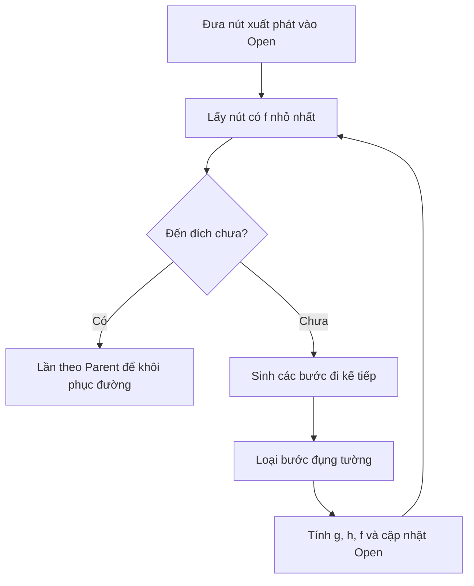
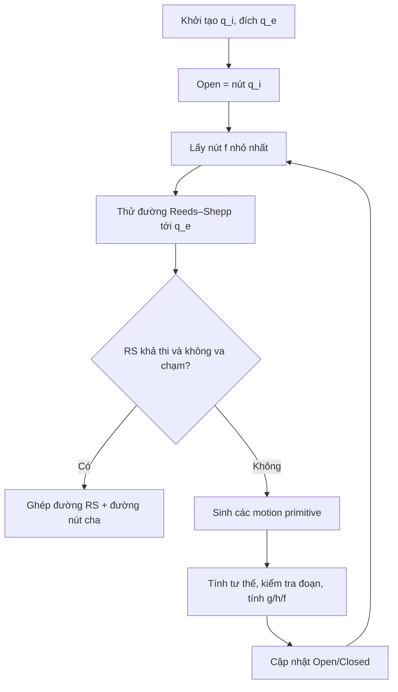

# 04 — Hybrid A*: tìm đường từ q_i đến q_e (giải từ thuật toán A* cơ bản)

> **Nguồn:** Section 3.4, công thức (29)–(31), tr. 13; mô hình xe Section 3.1 tr. 5–6. Bài báo gọi phương pháp là **improved hybrid A*** (Hybrid A* cải tiến) khi kết hợp Entry-point Guidance và mở rộng giải tích RS.
>
> **Mục tiêu:** hiểu từ con số 0: “nút”, “mở rộng nút”, `g`, `h`, `f`, chọn đường, kiểm tra va chạm và khác A* ở đâu.

## 1. Bắt đầu từ A*: tìm đường cho một chấm trên bản đồ

Giả sử bạn đi từ A đến B trên bản đồ kẻ ô. Mỗi ô có thể đi tới 4 ô bên cạnh (trên/dưới/trái/phải), ô có tường thì không được bước vào. Một thuật toán đơn giản có thể thử hết mọi đường, nhưng sẽ rất tốn thời gian.

**A\*** là cách **ưu tiên** thử các ô có tổng điểm dự kiến tốt nhất:

\[
\boxed{f(n)=g(n)+h(n)}.
\]

- `n`: một **nút** (*node*) — một trạng thái/điểm mà máy tính đang xét;
- `g(n)`: chi phí **đã trả** từ A đến `n`;
- `h(n)`: chi phí **ước đoán còn lại** từ `n` đến B;
- `f(n)`: tổng chi phí dùng để **xếp thứ tự** xem nên xét nút nào trước.

### Ví dụ số đơn giản

Bạn có hai cách tới đích:

- Nút P: đã đi `g=5m`, ước còn `h=3m` → `f=8m`.
- Nút Q: đã đi `g=4m`, ước còn `h=6m` → `f=10m`.

Máy tính ưu tiên mở rộng **P**, vì `8<10`. Không có nghĩa P chắc chắn cuối cùng sẽ tối ưu: còn phải xét các đường, vật cản và cách xây `h`.

### `Open list`, `Closed list` là gì?

- **Open list:** danh sách những nút đã phát hiện nhưng **chưa mở rộng**. Thường tổ chức bằng *priority queue* hoặc *heap*, để nhanh chóng lấy `f` nhỏ nhất.
- **Closed list:** những nút đã mở rộng, giúp tránh lặp vô ích.
- **Parent:** nút cha mà từ đó ta tới nút hiện tại. Lưu `parent` để cuối cùng **lần ngược lại đường đi**.



## 2. Vì sao A* trên ô lưới thông thường chưa đủ cho ô tô?

Một người có thể bước sang ngang một ô; xe ô tô không thể **dịch ngang** trong khi giữ nguyên hướng như vậy. Xe cũng không thể vừa đi vừa quay tại chỗ tùy ý.

**[DIỄN GIẢI]** Nếu dùng A* kiểu bàn cờ, máy tính có thể vẽ đường “đi thẳng 1m, rẽ phải vuông góc ngay tại điểm đó” — đây là một đường gấp khúc có thể không chạy được vì xe có bán kính quay nhỏ nhất.

Để tìm đường cho xe, mỗi nút phải biểu diễn **tư thế xe**, không chỉ tọa độ điểm:

\[
\boxed{q=(x,y,\theta)}.
\]

Đây là chữ **Hybrid** trong Hybrid A*: trạng thái vật lý `x,y,θ` biến thiên liên tục qua mô hình động học, nhưng máy tính vẫn dùng một cấu trúc tìm kiếm hữu hạn với các ngăn (bin) để quản lý trạng thái.

## 3. Một “nhánh mở rộng” được tạo như thế nào?

Từ nút hiện tại `q_k` ta chọn **động tác mẫu** (*motion primitive*), ví dụ:

- Tiến + lái trái;
- Tiến + lái thẳng;
- Tiến + lái phải;
- Lùi + lái trái;
- Lùi + lái thẳng;
- Lùi + lái phải.

**[DIỄN GIẢI]** Đây là cách chia dễ học khi dùng ba góc lái `{-δ_max,0,+δ_max}` × hai hướng tiến/lùi. **Bài báo không công bố bắt buộc dùng đúng 6 nhánh hoặc đúng ba góc lái này**. Nó chỉ xác nhận các ràng buộc góc lái, tiến/lùi và mô hình xe được đưa vào tìm kiếm.

Mỗi nhánh phải dùng công thức xe đạp (file 01) để tính tư thế mới. Ví dụ cho một bước thời gian:

\[
\begin{aligned}
x_{k+1}&=x_k+v\cos\theta_k\,\Delta t,\\
y_{k+1}&=y_k+v\sin\theta_k\,\Delta t,\\
\theta_{k+1}&=\theta_k+\frac vL\tan\delta\,\Delta t.
\end{aligned}
\]

**[ĐỀ XUẤT TRIỂN KHAI]** Đây là Euler rời rạc từ công thức (6), không phải cách tích phân duy nhất. Mỗi **đoạn** được mô phỏng bằng nhiều bước ngắn và kiểm tra va chạm **trên cả đoạn**, không chỉ ở đầu và cuối.

### Ví dụ điều gì xảy ra khi thử 6 nhánh

Một nhánh có thể bị loại vì:

1. Thân xe đụng xe khác;
2. Một đoạn trung gian đi qua vật cản;
3. Tư thế vượt khỏi bản đồ;
4. Độ cong đòi `|δ|>δ_max`;
5. Không phù hợp các giới hạn được chọn của hệ thống.

Nhánh không va chạm được đưa vào tập ứng viên với chi phí mới.

## 4. Công thức g(n) của bài báo, không thay bằng công thức khác

**[BÀI BÁO, công thức (30), tr. 13]**

\[
\boxed{
 g(n)=\sum_{k=0}^{K-1}
 \left[\Delta s_k+\alpha\,|\Delta\delta_k|+\beta\,I(v_k<0)\right].
}
\]

Hãy đọc từ trong ra ngoài:

- **`K`**: số đoạn ngắn tạo nên đường từ đầu tới nút hiện tại.
- **`Σ` (sigma):** ký hiệu “cộng tất cả”. `k=0` đến `K−1` nghĩa là lấy từng đoạn, cộng chi phí của tất cả đoạn.
- **`Δs_k`**: chiều dài đoạn `k` (m). Càng dài, chi phí càng tăng.
- **`δ_k`**: góc lái được dùng trên đoạn `k` (rad).
- **`Δδ_k`**: độ thay đổi góc lái khi bước sang đoạn này; `|Δδ_k|` là **mức thay đổi**, không quan tâm trái/phải. Ví dụ từ `+10°` sang `−10°` → độ thay đổi có độ lớn `20°`.
- **`α`**: hệ số quy đổi phạt thay đổi góc lái sang thang chi phí tương tự chiều dài.
- **`I(v_k<0)`**: *hàm chỉ thị* (*indicator function*). Nếu xe lùi trên đoạn `k` thì bằng `1`, còn tiến thì bằng `0`.
- **`β`**: hệ số phạt dùng số lùi.

Đây là cách làm cho máy tính ưu tiên đường **ngắn hơn**, **đánh lái ít thay đổi đột ngột hơn** và **không lùi quá nhiều** nếu không cần.

### Tại sao `Δδ`, không phải `δ`?

Nếu giữ nguyên một góc lái 10° qua nhiều đoạn, độ thay đổi mỗi lần có thể gần 0. Điều này tạo một cung cong tương đối đều. Nếu cứ đổi `+20° → −20° → +20°`, mỗi lần đổi sẽ bị phạt lớn hơn, giúp giảm hành vi đánh lái qua lại quá nhiều.

### Ví dụ tính số từ con số 0

**[DIỄN GIẢI]** Giả sử có **một** nhánh mới với:

- Dài `Δs=2,0m`;
- Góc lái thay đổi `Δδ=0,1rad`;
- Xe đang **lùi** (`I=1`);
- Chọn thử `α=2 m/rad`, `β=0,5m`.

Chi phí nhánh:

\[
\Delta g=2,0+2\times0,1+0,5\times1=2,7.
\]

Nếu nút cha có `g=5,0` thì nút mới có `g=5,0+2,7=7,7`.

**Quan trọng:** `α=2`, `β=0,5` ở đây là số tự đặt **để học phép tính**, **không phải** hệ số bài báo. Nghiên cứu nói `α,β,w_θ` được hiệu chỉnh theo thực nghiệm và yêu cầu động học nhưng **không cung cấp mọi giá trị số** để sao chép nguyên xi.

### Lưu ý khoa học về “phạt đổi chiều”

Công thức (30) chứa `β I(v_k<0)`, nghĩa là phạt **đoạn đi lùi**. Nó **không có hạng riêng** như `I(v_k v_{k-1}<0)` để đếm số lần **chuyển từ tiến sang lùi**. Mục tiêu giảm số lần điều chỉnh nêu trong bài có thể đến từ cả kiến trúc Entry Point và các bước khác, nhưng **không được nói công thức (30) trực tiếp đếm số lần đổi số**.

## 5. Công thức h(n) của bài báo: đo “còn cách đích bao xa”

**[BÀI BÁO, công thức (31), tr. 13]**

\[
\boxed{
 h(n)=w_p\sqrt{(x-x_g)^2+(y-y_g)^2}
 + w_\theta\min(|\theta-\theta_g|,\,2\pi-|\theta-\theta_g|).
}
\]

Đây có **hai phần**:

### 5.1. Khoảng cách tọa độ

\[
d=\sqrt{(x-x_g)^2+(y-y_g)^2}.
\]

Đây là **định lý Pythagoras**: hiệu theo trục x và hiệu theo trục y tạo hai cạnh vuông của một tam giác; độ dài đường chéo là căn bậc hai của tổng bình phương.

Ví dụ nút ở `(1,2)`, đích `(4,6)`:

\[
d=\sqrt{(4-1)^2+(6-2)^2}=\sqrt{9+16}=5m.
\]

### 5.2. Khoảng cách về hướng xe

Hai góc `0°` và `350°` nhìn qua tưởng chênh `350°`, nhưng trên vòng tròn chúng chỉ lệch nhau `10°` theo chiều ngược lại. Vì góc **quay hết một vòng trở về cùng hướng**, cần lấy độ lệch góc **ngắn nhất**.

Bài báo viết:

\[
d_\theta=\min(|\theta-\theta_g|,2\pi-|\theta-\theta_g|).
\]

Với các góc đã được quy về một vòng `0…2π`:

- `θ=10°`, `θ_g=350°`;
- `|10−350|=340°`;
- `360−340=20°`;
- `min(340°,20°)=20°`.

**[ĐỀ XUẤT TRIỂN KHAI]** Trong code nên chuẩn hóa bằng hàm `wrap_angle` để `|θ−θ_g|` luôn thuộc `[0,π]` trước khi áp dụng, tránh trường hợp góc chưa chuẩn hóa làm `2π−|Δθ|` âm.

### 5.3. Các trọng số `w_p`, `w_θ` là gì?

- `w_p`: hệ số coi trọng khoảng cách vị trí; tác giả nói **đặt `w_p=1` làm mốc**.
- `w_θ`: hệ số coi trọng việc đầu xe đã quay đúng hướng chưa.

Cần nhân trọng số vì “1 mét” và “1 radian” không phải cùng đơn vị đo. Hệ số là cách quy đổi và cân bằng hai lỗi theo một thang chi phí.

**Ví dụ [DIỄN GIẢI]:** cách đích `3m`, lệch hướng `30°≈0,524rad`, chọn `w_p=1`, `w_θ=0,5`:

\[
h=1\times3+0,5\times0,524=3,262.
\]

Số `0,5` là minh họa chứ không phải giá trị được công bố.

### Heuristic có tự né vật cản không?

**Không.** Nếu tường chắn giữa xe và đích, khoảng cách thẳng vẫn có thể nhỏ dù xe phải đi vòng rất xa. `h(n)` chỉ **dẫn hướng thứ tự tìm kiếm**; việc **loại va chạm** phải do mô hình và bản đồ riêng thực hiện.

**[CẦN KIỂM CHỨNG]** Việc thêm phạt góc với trọng số hiệu chỉnh có thể làm heuristic không còn là **cận dưới chấp nhận được** (*admissible*) của chi phí thực; từ bài báo không nên tự suy ra bảo đảm tìm ra đường ngắn nhất toàn cục.

## 6. Gộp lại g+h: một lần chọn nút hoàn chỉnh

Giả sử **[DIỄN GIẢI]** hai nút ứng viên A/B có:

| Nút | Đã đi `g` | Ước tính còn lại `h` | Điểm `f=g+h` |
|---|---:|---:|---:|
| A | 7,7 | 3,262 | 10,962 |
| B | 8,0 | 2,5 | 10,5 |

Máy tính ưu tiên **B** vì `10,5<10,962`, dù B đã đi dài hơn. Lý do B **có vẻ gần đích hơn theo đánh giá heuristic**.

Nếu sau khi mở rộng B, các nhánh đều đâm tường, máy tính **quay lại** xét các nút khác, không bắt buộc chọn B mãi.

## 7. Lưu trạng thái liên tục nhưng chỉ có RAM hữu hạn

`x,y,θ` là số thực. Về lý thuyết có vô số giá trị. Một máy tính không thể lưu vô số nút, nên phải chia vùng tìm kiếm thành các **ngăn rời rạc**:

- `ix = floor((x−x_min)/Δx_grid)`;
- `iy = floor((y−y_min)/Δy_grid)`;
- `iθ = floor(wrap_2π(θ)/Δθ_bin)`.

**[ĐỀ XUẤT TRIỂN KHAI]** Đây là cấu trúc phổ biến giúp tìm và loại các nút gần trùng, **không phải thông số ô lưới hoặc góc bin được bài báo công bố**. Chọn ô quá lớn sẽ mất đường trong chỗ hẹp; quá nhỏ sẽ tốn thời gian/RAM.

Trong thuật toán có phạt đổi góc lái và đi lùi, cùng một `(x,y,θ)` nhưng **hướng đi và góc lái trước** có thể tạo chi phí kế tiếp khác nhau. Vì vậy khi làm bộ khóa trùng nút và “điểm tốt nhất”, cần cân nhắc giữ thêm `direction` và `steer_prev`, hoặc không gộp các trạng thái thiếu tương đương.

## 8. Hybrid A* của bài báo có gì “cải tiến”?

Nhắc lại: công thức `f=g+h` **không mới**; nó là lõi A*. Sự cải tiến trong bài này ở **cách dẫn hướng và tích hợp hệ thống**:

1. **Trước khi lập đường từ nơi xe đứng, tìm một tư thế `q_e` khả thi** bằng Entry-point Guidance (file 03).
2. **Đặt `q_e` làm đích** tìm kiếm thay vì lao thẳng vào khu vực đỗ chật.
3. Dùng hàm chi phí có thành phần chiều dài, thay đổi lái và đi lùi.
4. **Tích hợp RS analytic expansion** để thử kết nối thẳng tới đích (file 05).
5. Kiểm tra va chạm bằng mô hình thân xe và hậu xử lý đường.

**[BÀI BÁO]** Section 3.4 mô tả rõ Hybrid A* có `R_min`, `δ_max`, giới hạn tiến/lùi, RS analytic expansion và kiểm tra va chạm.

## 9. Reeds–Shepp tham gia vào vòng lặp ở đâu?

Một quá trình dễ hiểu là:



**[CẦN KIỂM CHỨNG]** Lưu đồ trên là **pseudocode giảng dạy**, không phải lịch gọi RS chính xác trong code tác giả (tần suất thử, ngưỡng gần đích, tiêu chí dừng và giới hạn nút chưa được công bố đầy đủ).

## 10. Pseudocode học tập (không nhận là mã nguồn gốc)

```text
function PlanHybridAStar(start=q_i, goal=q_e, obstacle_map):
    open.push(start, priority=f(start))
    while open không rỗng và chưa vượt giới hạn tài nguyên:
        current = open.pop_lowest_f()
        if current đã giải quyết / không còn cải thiện: continue
        if current đủ gần và đúng hướng với goal: return build_path(current)

        rs = reeds_shepp(current.pose, goal.pose, R_min)
        if rs tồn tại và collision_free_along_entire_path(rs):
            return backtrace(current) + rs

        for each direction and permitted steering sample:
            primitive = propagate_kinematic_bicycle(current, direction, steering)
            if exceeds_map_or_steering_limits(primitive): continue
            if collides_at_any_sample(primitive): continue
            g_new = g(current) + length + steering_change_penalty + reverse_penalty
            h_new = distance_and_heading_heuristic(primitive.end, goal)
            if better_than_previous_equivalent_state:
                store parent and controls
                open.push(primitive.end, g_new + h_new)

    return FAILURE
```

Pseudocode minh họa 3 việc **bắt buộc tách riêng**: sinh chuyển động, kiểm tra va chạm, và tính chi phí. `FAILURE` là một đầu ra hợp lệ; không được điều khiển xe dựa trên đường chưa được xác minh.

## 11. Bài kiểm tra hiểu đúng

1. A* cho điểm `(x,y)`, Hybrid A* cho xe `(x,y,θ)`: khác gì khi rẽ? → Hybrid A* sinh chuyển động theo động học, tránh rẽ vuông tức thì.
2. `g` của bài báo có trực tiếp đếm số lần đổi tiến/lùi không? → Không; nó phạt **đoạn lùi**.
3. `h=0` liệu chắc chắn xe đã vào được ô? → Không nếu còn lỗi tư thế, va chạm hoặc điều kiện dừng chưa thỏa.
4. `g+h` nhỏ nhất có bảo đảm nhánh không va chạm? → Không; va chạm được kiểm bằng một bộ kiểm tra riêng.

**Đi tiếp:** [05_Reeds_Shepp.md](05_Reeds_Shepp.md).
