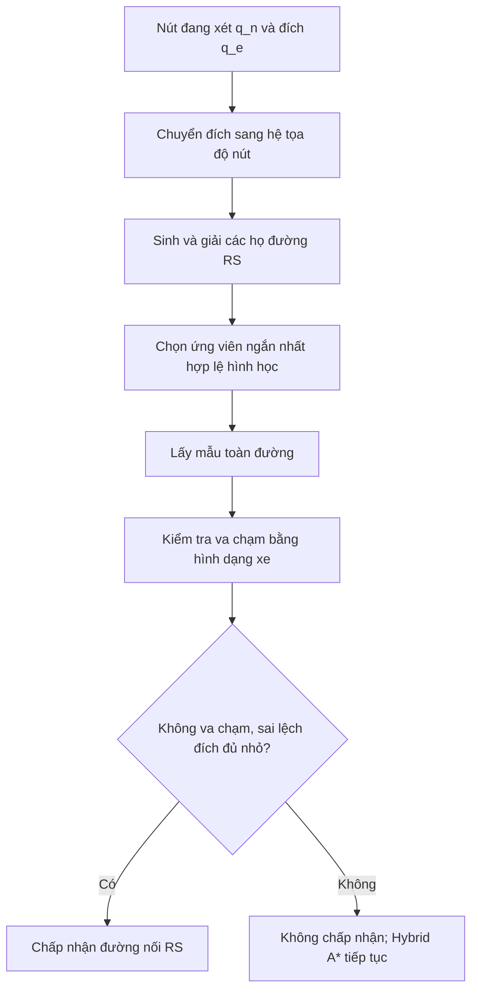

# 05 — Reeds–Shepp: đường thẳng và cung tròn để nối hai tư thế xe

> **Nguồn:** Section 3.4 tr. 13–14, công thức (32)–(33); nhóm đường `CSC`, `CCC`, `CCCC`, `CCSC`, `CCSCC`.
>
> **Mục tiêu:** hiểu từ các hình cơ bản đến thuật toán RS, vì sao nó giúp Hybrid A*, và vì sao nó **không thể tự tránh vật cản**.

## 1. Bài toán cốt lõi của RS

Cho hai tư thế xe:

\[
q_a=(x_a,y_a,\theta_a),\quad q_b=(x_b,y_b,\theta_b).
\]

Xe chỉ có thể:

- Di chuyển **tiến hoặc lùi**;
- Đánh lái trong giới hạn, dẫn đến bán kính quay tối thiểu `R_min`;
- Không trượt ngang tùy ý.

Câu hỏi RS giải là: **Trong mặt phẳng không có vật cản, làm sao nối hai tư thế trên bằng đường ngắn nhất nếu được phép tiến/lùi và giới hạn độ cong?**

Vì RS là bài toán đường ngắn hình học, nó **không tự biết** một chiếc xe khác đang chắn trước mặt. Va chạm là bước kiểm tra **sau khi sinh đường**.

## 2. Từ hình học lớp phổ thông đến đường xe

Đường cơ bản có ba loại:

- **S — Straight:** đoạn thẳng, giữ bánh lái thẳng `δ=0`;
- **L — Left:** cung tròn xe đánh lái trái;
- **R — Right:** cung tròn xe đánh lái phải.

**C** trong tên các nhóm RS là **Curve** (cung tròn), có thể rẽ trái hoặc phải. `CSC` nghĩa là **cung–thẳng–cung**; `CCC` nghĩa là ba cung nối tiếp; tương tự `CCCC`, `CCSC`, `CCSCC`.

> **Nhớ tách hai thứ:** `L/R` mô tả **hướng đánh lái**, còn `forward/reverse` mô tả **chiều chuyển động**. Khi lùi với góc lái trái, thân xe quay theo hướng khác so với khi tiến cùng góc lái.

## 3. Từ góc lái đến độ cong của đường

Đường tròn bán kính `R` có **độ cong** `κ` được định nghĩa:

\[
\boxed{\kappa=\frac{1}{R}}.
\]

Hiểu trực giác:

- Đường thẳng `R→∞`, vậy `κ→0` (không cong);
- Đường tròn bán kính `2m`, `κ=0,5 m^{-1}`;
- Đường tròn bán kính `10m`, `κ=0,1 m^{-1}`.

Từ mô hình xe đạp file 01:

\[
R=\frac L{\tan\delta}\quad\Longrightarrow\quad\kappa=\frac{\tan\delta}{L}.
\]

Vì xe bị giới hạn `|δ|≤δ_max`, độ lớn độ cong cũng phải thỏa:

\[
|\kappa|\le\frac{1}{R_{min}}.
\]

Đây là cách nói toán học của việc **không ép xe cua gấp hơn khả năng đánh lái**.

## 4. Chiều dài một cung tròn từ đâu ra?

Cho cung tròn bán kính `R`, góc quét `γ` (radian):

\[
\boxed{s_{arc}=R|\gamma|}.
\]

**Giải từ đầu:** Chu vi cả vòng `C=2πR`, góc cả vòng `2π` rad. Nếu chỉ đi góc `γ` thì tỷ lệ chiều dài là `|γ|/(2π)`, nên `s=C×|γ|/(2π)=R|γ|`.

Ví dụ `R=6m`, rẽ `90°=π/2rad`:

\[
s=6\times\pi/2=3\pi\approx9,425m.
\]

Nếu cong `30°=π/6rad`, cùng bán kính thì dài `6×π/6=π≈3,142m`.

## 5. Thế nào là một đường RS?

Một ứng viên có thể gồm:

```text
     [C trái, tiến] → [S, tiến] → [C phải, lùi]
```

hoặc

```text
     [C phải, lùi] → [C trái, lùi] → [C phải, tiến]
```

Đó chỉ là **ví dụ ý tưởng về một chuỗi cung/đoạn thẳng có dấu chiều chuyển động**; không được coi mọi chuỗi tự do đều là một nghiệm RS hợp lệ. Thuật toán phải giải các điều kiện hình học sao cho:

1. Nối liên tục các điểm;
2. Hướng xe tại chỗ nối đúng;
3. Tư thế cuối bằng tư thế mục tiêu;
4. Bán kính cong không nhỏ hơn `R_min`;
5. Các đoạn có chiều tiến/lùi hợp lệ.

Những chỗ **đổi từ tiến sang lùi** được gọi là **cusp** (điểm đổi chiều chuyển động). Khi chuyển qua cusp trong xe thật, cần dừng vận tốc về 0 trước khi đổi số và tăng tốc trở lại — đó là vấn đề của **bộ điều khiển**, không phải phép tính hình học RS.

## 6. Tại sao cần chuyển từ tọa độ bản đồ sang tọa độ của nút hiện tại?

**[BÀI BÁO, công thức (32)]** Để giải công thức RS chỉ một lần cho dạng chuẩn, tác giả đặt:

- Nút đang xét `q_n=(x_n,y_n,θ_n)` thành **gốc mới**;
- Hướng thân xe tại đó thành **trục x mới**;
- Tư thế đích được biểu diễn tương đối so với nút ấy.

Đầu tiên lấy **hiệu tọa độ**:

\[
\Delta x=x_g-x_n,\quad \Delta y=y_g-y_n.
\]

Nếu node ở `(2,1)` và goal ở `(5,5)`, thì goal lệch `(+3,+4)` so với node.

Tiếp theo quay vector ngược góc hướng của node (gọi là `R(-θ_n)`):

\[
\boxed{\begin{aligned}
x'&=\Delta x\cos\theta_n+\Delta y\sin\theta_n,\\
y'&=-\Delta x\sin\theta_n+\Delta y\cos\theta_n,\\
\theta'&=\theta_g-\theta_n.
\end{aligned}}
\]

**Vì sao quay ngược?** Vì node có thể đang hướng 90° trên bản đồ; nếu muốn nhìn thế giới theo **đầu xe**, ta phải xoay hệ tọa độ trở lại `−90°` để đầu xe hướng sang phải trong bài toán chuẩn.

### Ví dụ số

**[DIỄN GIẢI]** `q_n=(2,1,90°)`, `q_g=(2,4,90°)`:

- `Δx=0`, `Δy=3`;
- `cos90°=0`, `sin90°=1`;
- `x'=0×0+3×1=3`;
- `y'=−0×1+3×0=0`;
- `θ'=90°−90°=0`.

Trong hệ của **đầu xe hiện tại**, đích nằm cách 3 m **thẳng phía trước**, cùng hướng. Nhờ chuẩn hóa, nghiệm RS hiển nhiên là **một đoạn thẳng 3 m**.

**[ĐỀ XUẤT TRIỂN KHAI]** Góc `θ'` cần được chuẩn hóa về phạm vi thích hợp (thường `(-π,π]`) để tránh khác biệt `0°` và `360°`.

## 7. Thuật toán giải các họ đường RS như thế nào?

**[BÀI BÁO]** Tác giả duyệt năm loại họ đường lớn:

`CSC`, `CCC`, `CCCC`, `CCSC`, `CCSCC`.

Với mỗi họ (và các biến thể trái/phải, tiến/lùi), thuật toán giải các tham số:

- **`α`**: góc quét từng cung (radian);
- **`d`**: chiều dài từng đoạn thẳng (m).

Sau đó so sánh chiều dài các ứng viên **hợp lệ về hình học**:

\[
\boxed{M^*=\underset{M_i}{\arg\min}
\left(\sum_j\alpha_{i,j}\,R_{min}+\sum_k d_{i,k}\right).}\tag{33}
\]

Giải từng ký hiệu:

- `M_i`: ứng viên đường RS loại thứ `i`;
- `arg min`: **chọn ứng viên** làm giá trị biểu thức nhỏ nhất;
- `Σ_j α_{i,j}R_min`: tổng độ dài các cung tròn;
- `Σ_k d_{i,k}`: tổng chiều dài các đoạn thẳng;
- `M*`: ứng viên có tổng chiều dài nhỏ nhất trong số các ứng viên được xét.

### Ví dụ chọn đường

**[DIỄN GIẢI]** `R_min=6m`. Có hai đường hợp lệ:

- Đường A: hai cung tổng góc `π/2rad`, đoạn thẳng `2m` → dài `6×π/2+2≈11,425m`;
- Đường B: các cung tổng góc `π/3rad`, đoạn thẳng `6m` → dài `6×π/3+6≈12,283m`.

Nếu chỉ so **chiều dài hình học** của hai ứng viên, chọn A vì `11,425<12,283`.

**[CẦN KIỂM CHỨNG]** Trong phần mềm cần dùng **chiều dài không âm** cho cung và đoạn thẳng, ngay cả khi góc/hướng được mã hóa bằng dấu âm. Công thức (33) của bài viết gọn theo ký hiệu độ dài cung; không có nghĩa phép cộng độ dài được phép triệt tiêu khi xe lùi.

## 8. Tại sao một đường RS hợp lệ vẫn có thể bị loại?

Bạn thử nối thẳng từ xe tới Entry Point: RS tìm được một đường dài 5m. **Nhưng giữa hai điểm có xe khác đang đỗ.** RS chỉ giải bài toán hình học không vật cản, nên vẫn có thể vẽ đường **đi xuyên xe đó**.

Vì vậy:

1. Tạo đường RS ứng viên;
2. Chia đường thành nhiều điểm `p_j`;
3. Tính tư thế xe tại mỗi điểm;
4. Dùng mô hình 10 hình tròn để kiểm tra va chạm với vật cản;
5. **Nếu bất kỳ đoạn nào không hợp lệ: bỏ ứng viên nối đó**, tiếp tục Hybrid A*.

**[BÀI BÁO]** Đây là điều tác giả ghi rõ trong Section 3.4 tr. 14.



## 9. RS và Hybrid A* khác nhau ở bản chất

| Tính chất | Reeds–Shepp | Hybrid A* |
|---|---|---|
| Câu hỏi | Nối **hai tư thế** bằng đường ngắn trong không gian trống | Tìm đường qua một **bản đồ có chướng ngại** |
| Cơ sở | Hình học cung tròn/đoạn thẳng tiến-lùi | Tìm kiếm trạng thái + mô phỏng động học |
| Tự né vật cản? | Không | Có khi tích hợp collision checker |
| Tác dụng trong bài báo | Thử kết nối giải tích tới đích, giảm mở rộng nút | Tìm đường từ `q_i` đến `q_e` qua không gian phức tạp |
| Khi thất bại | Loại đường nối không hợp lệ | Tìm nhánh mới hoặc báo không tìm được đường |

**“Analytic expansion”** nghĩa là thay vì từng bước rất nhỏ như Hybrid A*, dùng một công thức/nhiều công thức hình học để **nhảy nối** từ một nút đến đích (miễn là qua kiểm tra va chạm). Nó không có nghĩa thuật toán sửa được mọi tình huống bế tắc.

## 10. Làm mượt đường: bài báo nói gì, và không nói gì?

**[BÀI BÁO]** Sau RS, tác giả chia đường theo dấu vận tốc thành các đoạn tiến `P_f` và lùi `P_b`, rồi nêu bước **nonlinear trajectory optimization** (tối ưu phi tuyến) để làm mượt (tr. 14). Các hình kết quả báo cáo góc hướng và độ cong được kiểm soát.

**[CẦN KIỂM CHỨNG]** Bài báo không nêu đầy đủ bài toán tối ưu (các biến quyết định, hàm mục tiêu, ràng buộc, solver, trọng số), nên **không thể viết lại chính xác bộ làm mượt chỉ từ phương trình (33)**. Hơn nữa, các cung tròn nối đoạn thẳng **có thể nhảy độ cong** tại điểm nối nếu chưa được làm mượt. Không nên nói “bản thân RS luôn có độ cong liên tục”.

Đối với xe thật, phải kiểm lại **va chạm sau làm mượt** vì khi sửa đường, thân xe có thể bị kéo gần vật cản.

## 11. Tự kiểm tra

1. `CSC` là mấy đoạn? → Cung, thẳng, cung.
2. RS có tự biết một xe đang chắn đường không? → Không.
3. `arg min` lấy số nhỏ nhất hay lấy **ứng viên** có số nhỏ nhất? → Lấy ứng viên.
4. Nếu `R_min=5m`, cung quay `180°` dài bao nhiêu? → `s=5π≈15,708m`.
5. RS có tự cho biết tốc độ theo từng mili giây không? → Không; nó giải đường hình học, cần bộ tốc độ/bám đường phía sau.

**Đi tiếp:** [06_Quy_trinh_hoan_chinh.md](06_Quy_trinh_hoan_chinh.md).
