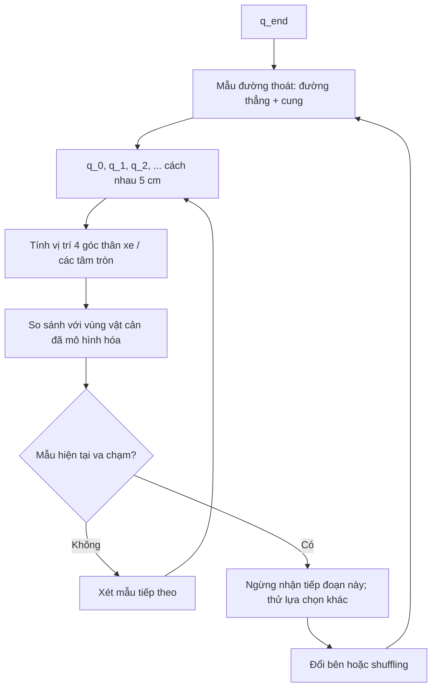
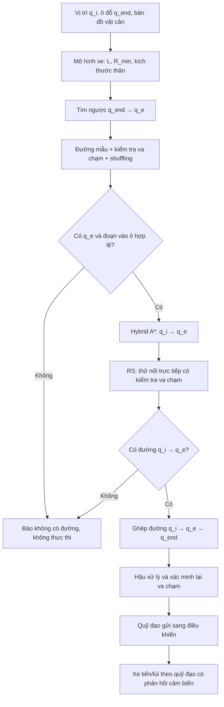

# 06 — Từ đầu đến cuối: một phiên đỗ xe sử dụng Entry Point + Hybrid A* + RS

> **Nguồn:** Section 2, Figure 1 tr. 4–5; Section 3.2–3.4 tr. 6–14; mô phỏng Section 4 tr. 14–18 và thử nghiệm xe thực Section 5 tr. 18–22.
>
> **Mục tiêu:** ghép bảy kiến thức rời rạc thành **một luồng xử lý duy nhất**. Bài này dành cho người đã hiểu từng phần nhưng vẫn chưa thể hình dung xe đi như thế nào.

## 1. Một câu chuyện duy nhất: xe cần đỗ giữa hai xe khác

Tưởng tượng bạn ngồi nhìn từ trên cao xuống bãi đỗ:

- Xe của mình đang ở ngoài làn đường, có một vị trí và góc hướng ban đầu;
- Hai bên ô đỗ có xe khác đã đỗ;
- Ô đỗ hẹp, nên nếu lao thẳng vào có thể mũi hoặc đuôi xe quẹt xe bên cạnh;
- Có thể cần **tiến/lùi nhiều lần** để chỉnh hướng.

Có ba mốc:

```text
 q_i (xe đang ở ngoài) ---> q_e (tư thế chuẩn bị đỗ) ---> q_end (xe đã ở trong ô)
        |                          |                             |
    Hybrid A* + RS             Điểm chuyển tiếp               Tư thế cuối
```

Đường từ `q_e` vào `q_end` do **bước tìm ngược** chuẩn bị. Đường từ `q_i` tới `q_e` do **Hybrid A* + RS** tạo ra.

## 2. Bản đồ ví dụ: hiểu khoảng hở trước khi tính đường

**[DIỄN GIẢI — KHÔNG PHẢI SCENARIO THỰC NGHIỆM CỦA BÀI BÁO]** Dùng hệ tọa độ nhỏ để tính tay:

- Xe mình: dài `3,0m`, rộng `1,5m`;
- Khi đỗ hoàn chỉnh, tâm thân xe ở `(4,2)`, quay `90°` so với trục x;
- Vật cản A chiếm vùng chữ nhật `x∈[1,5;3,1]`, `y∈[0,5;3,5]`;
- Vật cản B chiếm vùng chữ nhật `x∈[4,9;6,5]`, `y∈[0,5;3,5]`.

### 2.1. Thân xe ở tư thế đích chiếm đâu?

Xe dài `3m` nên bán chiều dài `1,5m`; rộng `1,5m` nên bán chiều rộng `0,75m`.

Với thân xe quay `90°`, chiều dài sẽ nằm theo trục `y`; chiều rộng nằm theo trục `x`. Vì vậy phạm vi thân xe là:

- `x` từ `4−0,75=3,25` đến `4+0,75=4,75`;
- `y` từ `2−1,5=0,5` đến `2+1,5=3,5`.

Hai vùng vật cản ở hai bên gần nhất tại `x=3,1` và `x=4,9`. Khoảng hở hình học mỗi bên là:

- Trái: `3,25−3,1=0,15m`;
- Phải: `4,9−4,75=0,15m`.

**Kết luận:** Tư thế cuối **không chạm vật cản** trong mô hình hình chữ nhật lý tưởng, nhưng **15cm mỗi bên là rất hẹp**. Con số này **chưa** trừ sai số cảm biến, dung sai xe hay đệm an toàn.

### 2.2. Vì sao quay đầu sớm lại đâm xe bên cạnh?

Xét một **tư thế giả định để minh họa phép kiểm tra va chạm**: vẫn lấy tâm `(4,2)` nhưng quay đầu xe từ `90°` sang `30°` (lưu ý: **đây không phải một bước động học hợp lệ thực hiện tức thời**, chỉ là một tư thế hình học để thử footprint).

Khoảng mở rộng ngang của hình chữ nhật quay góc `θ` tính từ tâm là:

\[
a_x=\frac{L_{car}}2|\cos\theta|+\frac{W_{car}}2|\sin\theta|.
\]

**Giải từ đầu:** Khi hình chữ nhật quay, nửa chiều dài tạo ra thành phần ngang `L_car/2 × |cosθ|`, còn nửa chiều rộng tạo ra thành phần ngang `W_car/2 × |sinθ|`; cực trị ngang bằng tổng hai độ lớn này.

Ở `θ=30°`, `cos30°≈0,866`, `sin30°=0,5`:

\[
a_x=1,5\times0,866+0,75\times0,5=1,674m.
\]

Nghĩa là vùng x của thân xe nằm trong:

\[
[4-1,674;\,4+1,674]=[2,326;5,674].
\]

Phạm vi này **chồng lên cả hai vùng vật cản** theo trục x; xét tiếp trục y có vùng chồng tương ứng, do đó tình huống xoay này gây va chạm. Vậy máy tính có thể loại kiểu tư thế này **mà không phải thử trên xe thật**.

**Ý nghĩa sâu nhất:** Một tọa độ tâm `(4,2)` có thể an toàn ở `θ=90°` nhưng nguy hiểm ở `θ=30°`. Đó là lý do nút tìm kiếm phải có **cả `θ`**.

## 3. Bước 0 — Thu thập dữ liệu ban đầu

**Đầu vào bắt buộc cho phép lập đường theo bài báo:**

- `q_i`: tư thế ban đầu (vị trí, góc);
- `q_end`: tư thế cuối mong muốn;
- Mô hình hình học bãi đỗ, ô đỗ và vùng vật cản;
- Kích thước thân xe, chiều dài cơ sở, `δ_max`, `R_min`;
- Các tham số cần thiết cho thuật toán tìm kiếm và kiểm tra va chạm.

Không có bản đồ vật cản thì thuật toán không thể xác định “đường đó đâm vào đâu”. Nếu chỉ có một cảm biến siêu âm báo một khoảng cách mà không biết hướng, tọa độ và các vật cản khác, chưa thể lập bản đồ 2D đáng tin cậy.

## 4. Bước 1 — Chuẩn bị mô hình xe

Từ `L_wheelbase`, `δ_max` tính:

\[
R_{min}=L_{wheelbase}/\tan(\delta_{max}).
\]

Tại mỗi tư thế, mô hình hình chữ nhật hoặc 10 hình tròn cho biết phần diện tích xe chiếm trên bản đồ.

**Phân biệt:** `L_wheelbase` là khoảng cách hai trục bánh; `L_car` là chiều dài toàn thân. Đây là hai số khác nhau!

## 5. Bước 2 — Tìm ngược từ tư thế đã đỗ

Máy tính chọn `q_end` làm gốc hệ ô đỗ cục bộ. Nó tạo đường mẫu **thẳng + cung 1/4 vòng** với:

\[
L_1=R_{min}+\Delta_{safe}.
\]

Sau đó biến đổi mẫu theo hướng thực tế của ô đỗ và thử cả hai phía trái/phải. Dọc mỗi mẫu, nó lấy các tư thế cách khoảng `0,05m` theo bài báo.

Một phiên tìm ngược **[DIỄN GIẢI]** có thể diễn ra như sau:

| Lượt | Việc máy tính thực hiện | Kết quả ví dụ |
|---|---|---|
| 1 | Dựng mẫu thoát bên trái | 12 tư thế đầu không va chạm; tư thế 13 chạm xe A |
| 2 | Dựng mẫu thoát bên phải | 21 tư thế đầu không va chạm; tư thế 22 chạm xe B |
| 3 | So sánh hai phía | Bên phải có đoạn liên tục dài hơn |
| 4 | Kiểm tra điều kiện góc/chiều dài | Chưa đủ hướng mục tiêu ở ngoài ô |
| 5 | Thử shuffling | Mẫu mới phải được kiểm tra va chạm lại từ đầu |
| 6 | Đạt điều kiện dừng hợp lệ | Có `q_e` và đường từ `q_e` vào `q_end` |

**Tất cả số mẫu và kết quả va chạm ở bảng là mô phỏng kể chuyện, không phải kết quả tính ra từ tọa độ ở mục 2.** Để tính quỹ đạo thật cần cả kích thước trục bánh và toàn bộ vật cản/bước tiến/lùi.

### Sơ đồ chi tiết việc kiểm tra va chạm trong bước tìm ngược



Điểm quan trọng: đây là **hàng trăm phép tính trên RAM**, xe thật vẫn đang dừng.

## 6. Bước 3 — Lấy được Entry Point thì chưa xong

Giả sử tìm được tư thế `q_e`. Cần giữ **cả đoạn đường hợp lệ từ `q_e` đến `q_end`**. Nếu chỉ lưu `q_e` nhưng làm mất các đoạn điều chỉnh, Hybrid A* có thể đưa xe tới `q_e` mà không biết đỗ tiếp ra sao.

Sau đó `q_e` trở thành **đích của bài toán lập đường từ nơi xe đang đứng**.

## 7. Bước 4 — Hybrid A* tìm từ q_i đến q_e

Ở mỗi trạng thái, Hybrid A* thử các lệnh `tiến/lùi + góc lái` bằng mô hình xe đạp. Mỗi đoạn được:

1. Tính trạng thái cuối từ công thức động học;
2. Lấy mẫu dọc đường và kiểm tra va chạm với bản đồ;
3. Chấp nhận hoặc loại;
4. Nếu chấp nhận, tính `g(n)` từ chiều dài + phạt đổi góc lái + phạt đi lùi;
5. Tính `h(n)` từ khoảng cách còn tới `q_e` + sai lệch hướng;
6. Đưa vào hàng đợi theo `f(n)=g(n)+h(n)`.

Không phải “phạt cao là va chạm”. **Va chạm** phải được loại bằng một phép kiểm tra **nhị phân** trước/độc lập với chi phí. Một đường đi xuyên tường dù dài 1mm cũng không được chấp nhận.

## 8. Bước 5 — RS thử nối giải tích để giảm tìm kiếm

Ở một nút `q_n`, thay vì tiếp tục mở rộng hàng loạt nhánh nhỏ, thuật toán có thể thử tìm đường RS từ `q_n` đến `q_e`.

- Nếu RS không có nghiệm hình học phù hợp → tiếp tục Hybrid A*;
- Nếu có nghiệm nhưng **đâm vật cản** → loại đường nối;
- Nếu có đường nối hợp lệ và sai số đích trong ngưỡng → nhận đoạn RS, tiết kiệm nhiều bước mở rộng nút.

**Nhắc lại:** RS **không** thay thế kiểm tra va chạm.

## 9. Bước 6 — Ghép thành đường đỗ đầy đủ

Gọi:

\[
P_1=P(q_i\rightarrow q_e),\qquad
P_2=P(q_e\rightarrow q_{end}).
\]

Toàn đường:

\[
\boxed{P=P_1\,\Vert\,P_2.}
\]

**`∥` ở đây ký hiệu phép nối chuỗi**, không phải phép nhân. Hãy hình dung nối hai danh sách điểm: danh sách đầu kết thúc ở `q_e`, danh sách sau bắt đầu ở đúng `q_e`.

**Ví dụ dữ liệu [DIỄN GIẢI]:**

```text
P_1: [(x0,y0,theta0,+), (x1,y1,theta1,+), ..., (xe,ye,thetae,+)]
P_2: [(xe,ye,thetae,-), ..., (xend,yend,thetaend,-)]
                                      ^
                               điểm nối q_e
```

Dấu `+/-` biểu diễn **chiều chuyển động trên đoạn**, không phải giá trị góc; khi đổi chiều cần một giai đoạn dừng thích hợp. Thực tế không nhất thiết toàn `P_2` đều là lùi: shuffling có thể gồm **nhiều đoạn tiến/lùi**.

**Cần kiểm tra trước khi phát lệnh:** tư thế nối có khớp không; đổi chiều có đánh dấu không; góc lái chuyển tiếp có khả thi không; tất cả đoạn sau làm mượt có còn an toàn không.

## 10. Bước 7 — Làm mượt và đưa vào bộ điều khiển

**[BÀI BÁO]** Section 3.4 đề cập chia đoạn theo dấu tốc độ thành các phần tiến và lùi, rồi tối ưu phi tuyến để làm mượt. Thử nghiệm trên Denza N7 triển khai planner bằng **C++ trên máy tính xe**, gửi các điểm quỹ đạo tới **MPC**, MPC điều khiển khung gầm.

**[CẦN KIỂM CHỨNG]** Bài báo không công bố tất cả công thức tối ưu phi tuyến nên không thể từ riêng nó phục dựng một bộ điều khiển hay bộ làm mượt y hệt.

Nếu đồ án STM32 dùng **Pure Pursuit + PID**, đó là **một lựa chọn kỹ thuật thay thế** ở tầng điều khiển, **không** phải mô tả thí nghiệm MPC nguyên văn của bài báo.

## 11. So sánh kết quả công bố, không áp sai cho STM32

**[BÀI BÁO, Section 4]** Với mô phỏng trên máy tính Intel i7-11800H/32GB RAM, MATLAB R2020b:

| Tiêu chí | Phương pháp tác giả | Baseline nghiên cứu |
|---|---:|---:|
| Tổng thời gian đỗ vuông góc | 0,888 s | 1,478 s |
| Tổng thời gian đỗ song song | 0,543 s | 32,700 s |
| Đường đỗ song song | 36,867 m | 51,493 m |
| Số thao tác điều chỉnh, song song | 6 | 10 |

**Baseline được mô tả là Hybrid A* không sử dụng RS analytic extension** (tr. 14); không được tự gọi baseline là “cùng đủ các thành phần nhưng chỉ bỏ riêng Entry Point”. Vì chưa có đủ nghiên cứu tách thành phần (*ablation study*) trong phần được cung cấp, không thể quy toàn bộ hiệu quả chỉ cho một cơ chế.

**Đặc biệt:** `0,543s` là thời gian tính toán mô phỏng công bố trong kịch bản cụ thể, **không** phải thời gian xe thật đỗ xong và **không** phải hiệu năng STM32.

## 12. Sơ đồ hệ thống cuối cùng



## 13. Khi nào phải “làm lại kế hoạch”?

**[ĐỀ XUẤT TRIỂN KHAI]** Ví dụ:

- Có vật cản mới xuất hiện (người đi bộ, ô tô khác);
- Xe lệch quá xa quỹ đạo dự kiến;
- Vị trí ước lượng không còn đáng tin cậy;
- Đo khoảng cách thực nhỏ hơn ngưỡng an toàn.

Khi ấy hệ thống phải **ưu tiên dừng an toàn** trước, cập nhật trạng thái/bản đồ, và chỉ lập lại đường nếu điều kiện cho phép. Đừng coi đường được lập trên bản đồ cũ là chắc chắn an toàn mãi mãi.

## 14. Bài kiểm tra tổng hợp

**Câu 1:** Vì sao có `q_e` rồi vẫn cần Hybrid A*? → Vì xe thật còn ở `q_i`, chưa tới tư thế chuẩn bị vào ô.

**Câu 2:** Nếu đường tìm ngược bị vật cản chặn, có thể dùng đường đó không? → Không; phải chọn đoạn hợp lệ, thử mẫu/shuffling khác hoặc báo thất bại.

**Câu 3:** RS báo một đường dài 3m, nhưng đường xuyên xe khác, có nhận không? → Không, loại khi kiểm tra va chạm.

**Câu 4:** Vì sao phải giữ hướng `θ` ở mỗi điểm? → Vì thân xe có hướng và có giới hạn quay; hai tư thế cùng tọa độ có thể khác an toàn và khác khả năng thực thi.

**Câu 5:** Bộ điều khiển MPC có phải là Hybrid A* không? → Không. Hybrid A* **lập đường**; MPC **điều khiển bám đường** ở xe thật trong thí nghiệm.

**Đi tiếp:** [07_Trien_khai_STM32.md](07_Trien_khai_STM32.md) — khi muốn chuyển từ mô hình nghiên cứu sang phần cứng nhúng.
